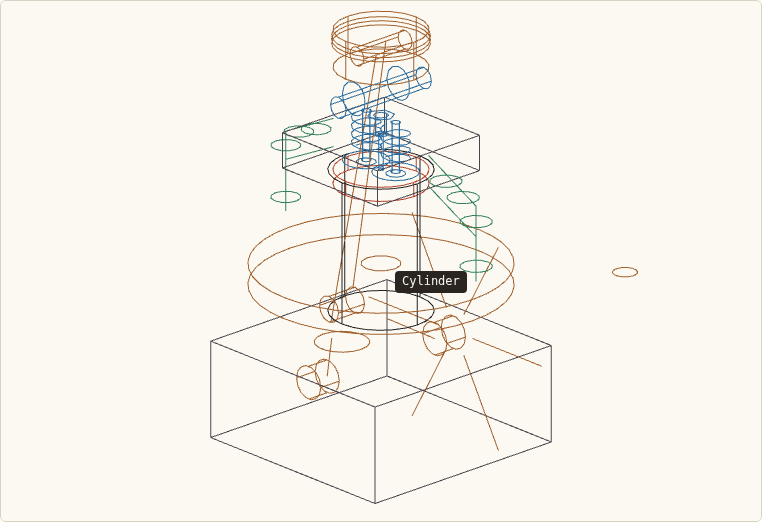

# Anatomy machines — interactive isometric engine figure, judged headlessly

Showcases the [anatomy](https://github.com/wheresryan22/anatomy) agent
skill (MIT licence, pinned commit `e6600ffc4e8e`) — "describe a machine in
one line, get an interactive isometric wireframe you can rotate and
inspect" — running end to end inside a disposable agent-next sandbox. The
artifact is one self-contained HTML file: raw WebGL isometric wireframe
of a four-stroke engine, drag-to-orbit camera, clickable labelled parts.
A judge the figure cannot fool decides whether it is real: headless
Chromium (Playwright 1.60.0 + Chrome Headless Shell 148.0.7778.96,
sha256-checked, SwiftShader WebGL on CPU) drags the canvas itself,
screenshots the pixels, reads the parts list out of the DOM, clicks every
part and counts animation frames. A sandbox helps because the whole
browser toolchain (~120 MB download plus system libraries) is installed,
run and thrown away without touching your machine — no GPU, no X server.

Gates and thresholds are in [SPEC.md](SPEC.md); measured results and real
command output are in [RECEIPT.md](RECEIPT.md).

## What the judge saw



Real frames from a passing run (seed 42): `media/angle_0..2.png` are the
canvas after successive 240 px drags, `media/spin_*.png` a mid-drag frame
series — provenance in [media/MANIFEST.json](media/MANIFEST.json).

- Canvas variance **661 / 653 / 668** at the three angles (floor 50) —
  not blank.
- Rotation is real: **5.2 / 5.5** mean pixel difference and **6 %** of
  pixels changed between angles.
- Parts recall **17/17** vs the textbook reference list
  (`judge/reference/four-stroke-engine.json`, sources cited inside);
  floor 0.8, zero duplicates.
- Clicking all 17 parts shows the name + description; **17/17** pass.
- Frame rate under SwiftShader on 2 vCPU: **~46 FPS** measured (floor 10).
- Self-test kills **6/6** known-bad mutants (blank canvas, missing parts,
  console error, frozen camera, wrong labels, dead interaction).

## Ask your agent

> Create a CPU sandbox. In it, clone https://github.com/agent-next/sandbox
> and run `bash cookbook/anatomy-machines/judge/setup.sh` to install the
> pinned headless-Chromium judge. Then, using the anatomy skill
> (https://github.com/wheresryan22/anatomy), build a figure directory for
> "a four-stroke engine": one self-contained HTML file with a WebGL
> isometric wireframe you can drag to orbit, a parts list of
> `data-part` elements, and a `data-part-info` panel that shows each
> part's name and description on click. Iterate with
> `bash cookbook/anatomy-machines/judge/grade.sh <your-figure-dir>` until
> every gate passes. Report the final verdict JSON and kill the sandbox
> when done.

## One-command run (with sandbox API)

```bash
export SBX_API_KEY=<your key>
pip install "git+https://github.com/agent-next/sandbox#subdirectory=cli"
python3 cookbook/anatomy-machines/run.py        # add --ref <branch> or --keep
```

`run.py` creates a sandbox, clones this repo at `--ref` (default `main`),
runs `judge/setup.sh`, `judge/selftest.sh`, grades the known-good figure,
prints the verdict JSON, and kills the sandbox (verifying it is gone)
unless `--keep` is given.

## In-sandbox / no API key (any Debian 12 box, 2 vCPU, ~3 GB RAM)

```bash
# 1. Install the pinned judge toolchain (~40 s warm mirror)
bash judge/setup.sh

# 2. Self-test: proves the judge can fail (good + 6 mutants, ~2.5 min)
bash judge/selftest.sh

# 3. Grade the known-good figure (seed 42 for reproducibility)
bash judge/grade.sh examples/good/four-stroke-engine \
    --json /tmp/verdict.json --seed 42
```

### `judge/grade.sh` flags

| flag | purpose | example |
|---|---|---|
| `--json FILE` | write verdict JSON to `FILE` | `--json /tmp/v.json` |
| `--seed N` | seed recorded in the verdict JSON | `--seed 42` |
| `--shots DIR` | save the canvas screenshots the judge takes (3 angles + an 8-frame drag series) | `--shots /tmp/shots` |

The judge is deterministic at any fixed seed: SwiftShader renders
identically and the drags are scripted pixel-exact. Only wall time and
measured FPS (under `timing`) vary between runs.

## Measured wall times (2 vCPU, Debian bookworm, this sandbox)

| step | wall time |
|---|---|
| `judge/setup.sh` (cold, incl. ~119 MB browser download) | ~40 s |
| `judge/selftest.sh` (2 good grades + 6 mutants) | ~2 m 18 s |
| `judge/grade.sh examples/good/four-stroke-engine` | ~19–22 s |

## Sources and credit

- Upstream project: **anatomy**, https://github.com/wheresryan22/anatomy,
  MIT licence, pinned commit
  `e6600ffc4e8e6620eeb45bf49bcdbd5e4b84163f` (licence vendored at
  `judge/anatomy-upstream/LICENSE`).
- The reference parts list is a standard textbook four-stroke
  description (Heywood, *Internal Combustion Engine Fundamentals*, ch. 1.2
  — cited in `judge/reference/four-stroke-engine.json`).
- The known-good figure was written for this demo in the kit's format;
  the judge cares only about the DOM contract in SPEC.md, not who drew
  the engine.

## Limits

- SVG/isometric figures only — upstream's beta 3D mode is out of scope.
- Only `four-stroke-engine` ships as a graded machine; adding another
  means writing `judge/reference/<machine>.json` from a cited source.
- The judge grades the DOM contract, not the drawing's engineering
  fidelity — it verifies a real rotating labelled WebGL figure, not that
  every wire is in the right place.
- `run.py` needs the `sbx` CLI and `SBX_API_KEY`; without them use the
  in-sandbox commands above.
