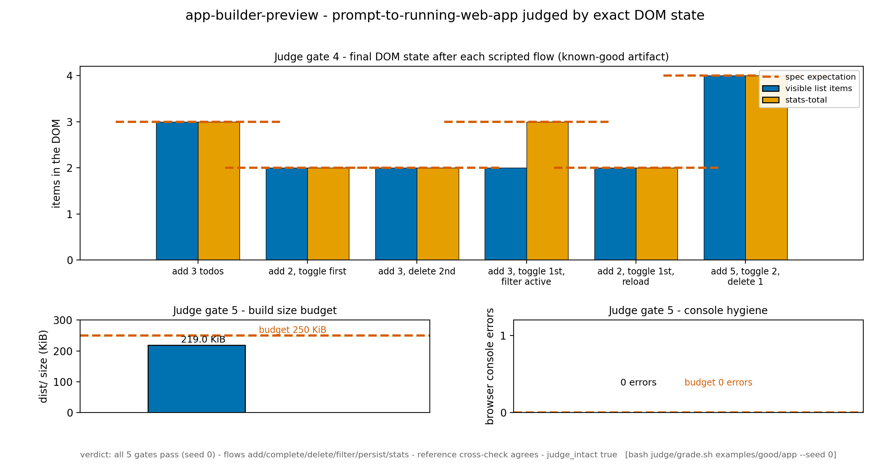
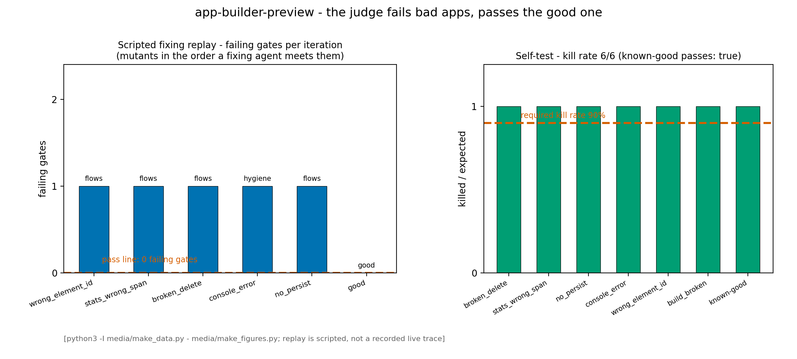

# app-builder-preview — a prompt-to-running-web-app demo a judge can grade

An agent works on a real front-end problem inside a disposable sandbox: it
is handed `judge/spec.json` — a neutral app spec (routes, element names,
behaviours, no implementation) — and must produce a Vite 8 + React 19 todo
app with live stats that builds, serves and persists. The judge never
accepts "the page loaded": it runs `npm ci` and `npm run build`, serves
`dist/`, then drives headless Chromium through 6 scripted user flows,
asserting **exact DOM state** after every step (item counts, texts,
classes, stats), plus a build-size budget, zero console errors, and a
cross-check against the judge's own reference app built from the same
spec. A sandbox is the right place for this: the agent needs Node, npm and
a real browser in a throwaway filesystem, and the graded artifact is a
small source tree it hands back.

## Results





[▶ demo.mp4](media/demo.mp4) — 43 s step-through of the 6 judged flows (the
judge's own screenshots) with expected and measured DOM state, then the two
figures (1920×1080, H.264, ~0.5 MB)

Key numbers from the judge verdict (`examples/good/app`, seed 0):

- **Flows**: 6/6 pass — every assertion is an exact DOM equality
- **Reference cross-check**: agrees on all 6 flows
- **Build size**: 219 KiB of the 250 KiB budget
- **Console errors**: 0
- **Self-test kill rate**: 6/6 = 100 % (requirement ≥ 90 %)

## Ask your agent

> Set up a sandbox and solve the demo in `cookbook/app-builder-preview/`
> of https://github.com/agent-next/sandbox (clone it first). Run
> `bash cookbook/app-builder-preview/judge/setup.sh`, read
> `cookbook/app-builder-preview/SPEC.md`, then build the artifact yourself:
> a Vite + React app in `app/` that fulfils every element and behaviour in
> `judge/spec.json` (the element names in the spec are the DOM ids; the app
> must read the spec at runtime with `fetch('/spec.json')`, never hardcode
> the ids). The judge copies its own `spec.json` in for every build, and an
> artifact that ships a `public/` directory is rejected. Iterate with
> `bash cookbook/app-builder-preview/judge/grade.sh <your-app-dir>
> --json v.json` until it exits 0, then paste the final verdict JSON. Do
> not edit anything under `judge/`; if you believe the judge is wrong, say
> so instead of working around it. Kill the sandbox when you are done.

The known-good example in `examples/good/app` is one working answer; a
working answer does not have to be it (the judge's own `judge/ref_app` is
a second, deliberately different one).

## One-command run

```bash
pip install "git+https://github.com/agent-next/sandbox#subdirectory=cli"
export SBX_API_KEY=<your key>
python3 cookbook/app-builder-preview/run.py          # --ref main --keep supported
```

Creates a sandbox, clones the repo at `--ref` (default `main`), checks the
demo's file layout, installs the pinned toolchain, runs the judge
self-test, grades `examples/good/app`, prints the verdict JSON and a short
summary — then always kills the sandbox and confirms with `sbx list` that
it is gone. Stdlib only; exits non-zero on any failure, naming the sandbox
id if cleanup could not be confirmed.

## Measured wall time (default-template sandbox, 2 vCPU)

| step | wall time |
|---|---|
| `git clone --depth 1` | ~5 s |
| `judge/setup.sh` (fresh install: Node tarball, 2 Chromium zips, npm cache) | ~150 s (idempotent re-run: ~3 s) |
| `judge/selftest.sh` (good + 6 mutants + determinism double-grade) | ~410 s |
| `judge/grade.sh examples/good/app` (build + serve + 6 flows + reference) | ~65 s |

A full `run.py` from `sbx create` to confirmed kill is ~11 minutes; the
sandbox is created with a 30-minute lifetime, which the run fits with
margin. `run.py` prints a per-step timing line.

## Limits, plainly

- Client-side only: no backend, no network calls; persistence is
  `localStorage`, which is also why every judged flow starts from a fresh
  browser context.
- The judge drives exact DOM state, not aesthetics: screenshots are
  captured for humans (`grade.sh --shots DIR`), never scored.
- x86-64 Linux only (`setup.sh` checks `uname`): Node and Chromium builds
  are pinned to that architecture.
- The Playwright Python binding (1.63.0) ships with the sandbox image and
  is version-checked, not installed; on an image without it `setup.sh`
  fails loudly instead of guessing.
- Chromium's two pinned CDN zips (~315 MB) are sha256-checked downloads —
  the one part of setup that needs real bandwidth.
