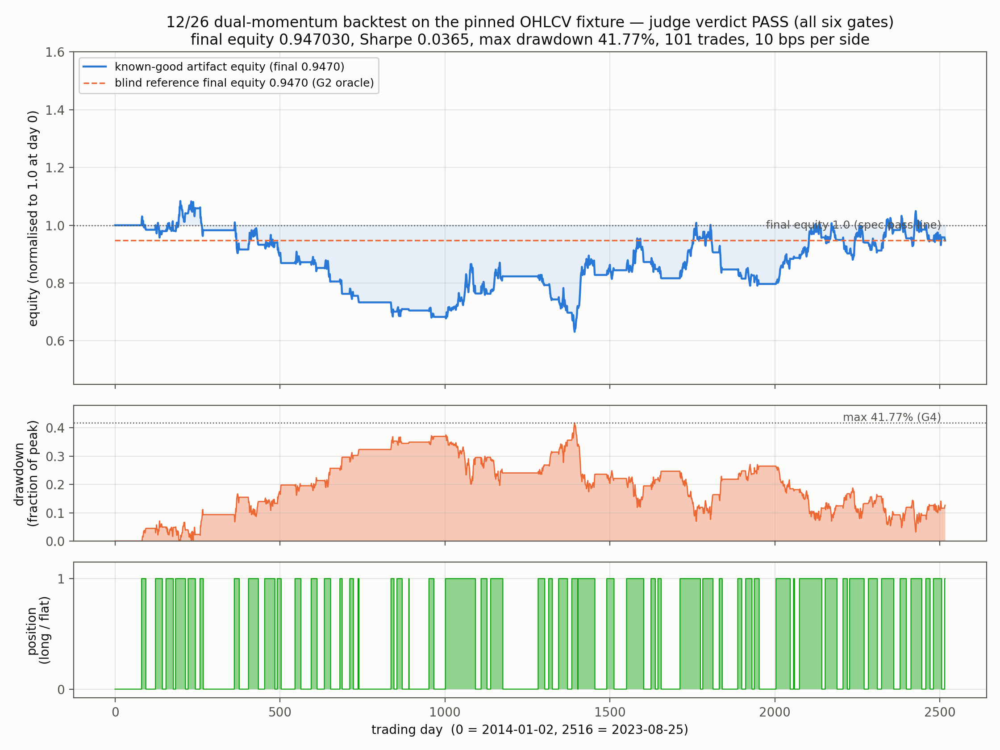
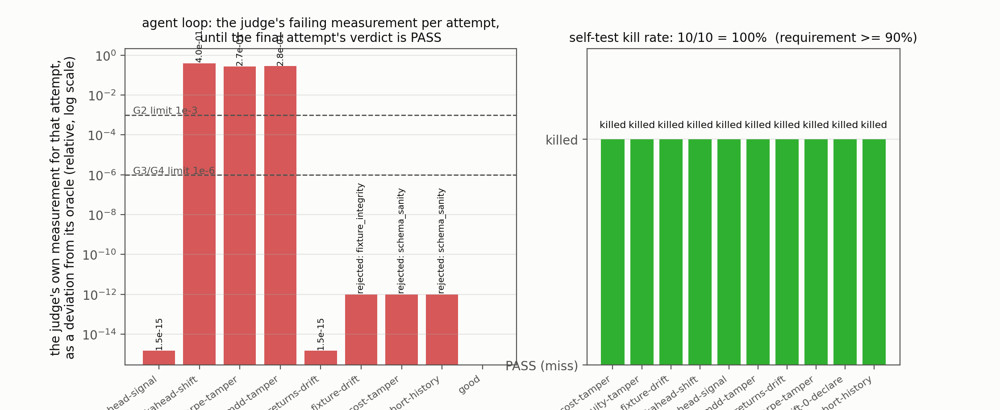

# backtest-equity — momentum backtesting a judge can grade

An agent backtests a 12/26 dual-momentum strategy on a pinned, synthetic
daily OHLCV fixture with 10 bps proportional transaction costs, inside a
disposable agent-next sandbox. The deliverables — the agent's own
vectorized engine, its equity curve, its max drawdown and its Sharpe ratio
— are graded by a judge it cannot fool: a *blind* reference implementation
written as a deliberately different (loop-based, stdlib-only) code path,
a Sharpe self-consistency check against the artifact's own return series,
and a lookahead negative control that fails any engine whose equity does
not change when the signal lag changes. A backtest that merely "runs" and
produces plausible numbers fails. A sandbox is the right place for this
because the agent needs numpy and matplotlib plus a throwaway filesystem to
iterate an engine in, and the graded artifact is a handful of small files
it hands back.

Strategy convention (fixed, one parameter set): signal `+1` while
`sma12(close) > sma26(close)`, else flat; the position held over `[t, t+1)`
is the signal observed at the close of `t − lookahead_shift`, and 10 bps of
notional is charged on every position change.

## Results





[media/demo.mp4](media/demo.mp4) — 32 s: the equity curve, the drawdown
panel and the position panel drawn day by day, then the agent loop's error
per iteration and the self-test kill rates (1920×1080, H.264).

Key numbers from the judge verdict on `examples/good` (fresh sandbox run
recorded in RECEIPT.md, `judge/grade.sh examples/good --seed 42`):

- **Verdict: PASS** — all six gates pass
- **Final equity**: 0.9470302914, exactly the blind reference's 0.9470302914
  (relative deviation 0.000e+00, limit 1e-03)
- **Sharpe**: 0.0365365875 — matches the Sharpe recomputed from the
  artifact's own `returns.csv` to 3.1e-15 (limit 1e-06)
- **Max drawdown**: 0.4177213784 (41.77 %) — matches the drawdown recomputed
  from the same CSV to 2.9e-12 (limit 1e-06)
- **Lookahead control**: the reference's final equity moves from 0.9470
  (shift 1) to 0.6763 (shift 2) as required, so the engine is really
  trading the signal
- **Self-test kill rate**: 10/10 mutants = 100 % (requirement ≥ 90 %)
- The strategy is *deliberately mediocre*: total return −5.3 % on this
  fixture. The judge grades correctness, not cleverness.

## Ask your agent

> Set up a sandbox and solve the demo in `cookbook/backtest-equity/` of
> https://github.com/agent-next/sandbox (clone it first). Run
> `bash cookbook/backtest-equity/judge/setup.sh` (installs the pinned
> numpy + matplotlib into `~/.venvs/backtest-equity`), read
> `cookbook/backtest-equity/SPEC.md`, then write the artifact yourself:
> a directory holding `backtest.py` (your engine), `ohlcv.csv` (copy of
> `tools/data/ohlcv.csv`), `returns.csv` (`date,ret` of the strategy's net
> daily returns), `metrics.json` (the metrics listed in SPEC.md) and
> `equity.png`. Trade signal: `+1` while `sma12(close) > sma26(close)`
> else flat, position lagged `lookahead_shift` bars, 10 bps per position
> change. Iterate with
> `bash cookbook/backtest-equity/judge/grade.sh <your-dir> --json v.json`
> until it exits 0, then paste the final verdict JSON. Do not edit anything
> under `judge/`; if you believe the judge is wrong, say so instead of
> working around it. Kill the sandbox when you are done.

The known-good example in `examples/good/` is a vectorized numpy engine;
a working answer does not have to be — any engine whose output agrees with
the blind reference is fine.

## One-command run

```bash
pip install "git+https://github.com/agent-next/sandbox#subdirectory=cli"
export SBX_API_KEY=<your key>
python3 cookbook/backtest-equity/run.py          # --ref main --keep supported
```

Creates a sandbox with `--timeout-min 45`, clones the repo at `--ref`
(default `main`), runs `judge/setup.sh`, `judge/selftest.sh` and
`judge/grade.sh examples/good --seed 42` (the seed is fixed in `run.py`),
prints the verdict JSON and a summary line, then kills the sandbox and
confirms with `sbx list` that its id is gone. Stdlib only. Exits non-zero if
any step fails, naming the sandbox id if cleanup could not be confirmed.

`--ref` defaults to `main`, which is correct once this demo is merged. Until
then the demo only exists on its own branch, so pass the branch ref:

```bash
python3 cookbook/backtest-equity/run.py --ref <the demo's branch>
```

Without the `sbx` CLI or a key, the same steps run in any Debian 12 box,
from the demo directory (`cookbook/backtest-equity/`):

```bash
bash judge/setup.sh
bash judge/selftest.sh
bash judge/grade.sh examples/good --seed 42 --json verdict.json
```

## Measured wall time (Debian sandbox, 2 vCPU)

| step | wall time |
|---|---|
| `git clone --depth 1` | 9 s |
| `judge/setup.sh` (fresh install) | 60–90 s (idempotent re-run: ~1 s) |
| `judge/selftest.sh` (good + 10 mutants + determinism) | 10–15 s |
| `judge/grade.sh examples/good` | 6–7 s |

Whole run, including sandbox create and kill: about two minutes, dominated
by the pinned wheel download. `run.py` prints a per-step timing line.

## How the judge works

- `judge/setup.sh` — installs the pinned numpy 2.2.6 / matplotlib 3.9.4
  wheel set (and its eight dependencies) with `pip --require-hashes` into
  `~/.venvs/backtest-equity`, verifies the pinned fixture's sha256, and
  writes `judge/VERSIONS.txt` with the versions it actually installed.
- `judge/reference.py` — the blind oracle. A scalar loop over the CSV,
  stdlib only, sharing no helper with the agent's engine: it computes the
  signal, the lag, the costs and every metric in the plainest possible way,
  so agreement with the artifact means the artifact is right rather than
  that both made the same off-by-one mistake.
- `judge/grade.sh <artifact> [--seed N] [--json out.json]` — runs gates G1
  (fixture sha256), G2 (final equity vs the blind reference, ≤ 0.1 %),
  G3 (Sharpe vs the artifact's own `returns.csv`, < 1e-6), G4 (max
  drawdown from the same CSV, ≤ 1e-6), G5 (lookahead negative control) and
  G6 (schema sanity), prints one JSON verdict, exits 0 only if all pass.
  Wall time lives under a `timing` key; everything else is a pure function
  of the pinned fixture, the artifact and `--seed`, so two runs with the
  same seed are byte-identical. The artifact is copied to a temp dir first.
- `judge/selftest.sh` — the good artifact must pass, all ten mutants
  (`judge/mutants.py`) must fail (each kill line and the kill rate are
  printed), the good artifact graded twice with `--seed 42` must give
  identical JSON except `timing`, and `judge/`'s checksum must be unchanged
  by grading.

## Limits, plainly

- Synthetic data: `tools/make_fixture.py` generates the fixture from a
  fixed seed with the Python standard library only. No live data, no
  corporate actions, no missing values — data quality beyond schema
  validation is out of scope (SPEC non-goals).
- Proportional costs only: 10 bps one-way on position changes, no
  slippage, market impact, margin, borrow or position limits.
- The strategy is one fixed parameter set (12/26, 10 bps). The judge says
  nothing about whether it is *good* — a negative Sharpe is not a failure.
- The judge does not execute the artifact's engine, so it cannot grade its
  style or runtime, only the numbers it reports.
- The wheels in `judge/requirements.txt` are CPython 3.12 manylinux
  x86_64; a different interpreter major/minor version would need its own
  pins (setup.sh fails loudly rather than mixing versions).
