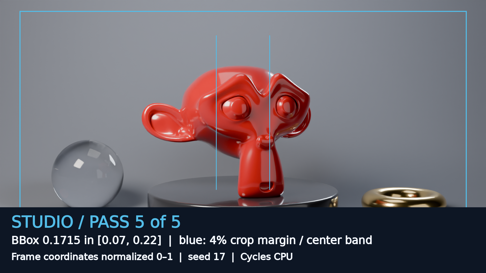

# Blender studio: render it, then prove it

An agent designs a studio product shot and a seamless turntable in a disposable
`blender` sandbox on https://sbx.agent-next.com. Blender 5.2.2 LTS renders the
red car-paint hero, glass orb, gold torus and cyclorama; an independent numeric
judge checks framing, exposure, backdrop continuity, animation and light
linking. The sandbox provides the large renderer and system libraries without
installing them on your computer, and is deleted after the run.



[Watch the 1080p demo](media/demo.mp4) · [Judge specification](SPEC.md) ·
[Two-run receipt](RECEIPT.md)

The two launch runs are verified, and the shipped media comes from one fresh,
complete sandbox capture with every file checksum-verified; see the receipt.

## Ask your agent

> In an agent-next sandbox with template `blender`, improve
> `cookbook/blender-studio/examples/good/scene.py` using only its eight SETTINGS.
> Keep the red hero centered and fully in frame, the sweep smooth, the lighting
> unclipped, and the 12-frame turntable seamless. Preserve Products-only rim
> linking and Backdrop-only halo linking. Run `sh judge/setup.sh`, then
> `sh judge/grade.sh examples/good/scene.py --seed 17 --json verdict.json`.
> Read the failed numeric gates, repair the scene, and repeat until all five pass.
> Do not edit the judge. Run its self-test and delete the sandbox when finished.

## One-command run

Prerequisites: Python 3.10+, Git, `sbx`, and `SBX_API_KEY` (or `E2B_API_KEY`)
already in your environment. Obtain your key through the public service; never
put it in the scene or a committed file.

```sh
pip install "git+https://github.com/agent-next/sandbox#subdirectory=cli"
cd cookbook/blender-studio
python3 run.py
```

The runner uses only the standard library. It creates template `blender` with
a 30-minute idle timeout, clones public `main`, uploads the local demo's small source
snapshot, verifies pinned tools, grades good twice and ten mutants, then
grades good again. It prints verdict JSON, times, clone SHA and snapshot digest.
It always kills in `finally` and confirms the ID is absent from `sbx list`.
Failure, including unconfirmed cleanup, exits nonzero.

`--ref <branch-or-tag>` changes the cloned ref; local judge/scene files still
come from the printed source snapshot. This is intentional so the same command
works before the new demo is published. `--seed N` changes the seed; `--keep`
explicitly leaves a sandbox alive and prints its ID. Delete it with `sbx kill ID`
and confirm using `sbx list`.

The receipt records measured wall times for create, clone, snapshot, setup,
self-test, grade and cleanup from two fresh sandboxes. The CPU target is under
five minutes, not a promised service latency: the shared CPU pool can be heavily
contended. Full-resolution media rendering is separate from the launch path.

| measured step | run A | run B |
| --- | --- | --- |
| create / clone / snapshot | 1.2 / 10.1 / 2.3 s | 6.1 / 11.5 / 20.5 s |
| pinned setup | 13.8 s | 17.3 s |
| good twice + ten mutants | 142.1 s | 154.4 s |
| final grade | 22.8 s | 23.5 s |
| time-to-result | **192.3 s** | **233.2 s** |
| total including confirmed cleanup | 198.7 s | 236.4 s |

Both fresh runs used `python3 run.py`, seed 17. Complete stdout and gate
numbers are in [RECEIPT.md](RECEIPT.md).

## Inside a sandbox

```sh
sh judge/setup.sh
sh judge/selftest.sh --seed 17
sh judge/grade.sh examples/good/scene.py --seed 17 --json verdict.json \
  --renders outputs-good
```

`outputs-good/hero.png` is the judged result; `endpoint.png`, `rim-on.png`,
`rim-off.png` and `measure.json` are the evidence. The allowed script syntax is
in [SPEC.md](SPEC.md). Submitted Python is parsed, not executed, so a script
cannot monkeypatch Blender, emit a forged score, or rewrite the judge.
The trusted factory is an original implementation of the template product-shot
recipe, cited with the inspected source digest in the specification.

## Media

To regenerate the full-resolution still, turntable and video:

```sh
sh media/make_media.sh
```

This creates another fresh sandbox with a 180-minute media-only timeout (a lifetime: status polls do not extend it), runs self-test, renders the actual scene
and 48 turntable poses at 1920×1080, downloads only render evidence, deletes the sandbox,
then builds figures and a lossless master plus the H.264 web clip using local
FFmpeg 6.1.1-3ubuntu5 and Pillow 10.2.0. The large source frames, blend file and lossless master
are ignored by Git. Command, seed, render time and hashes live in
`media/MANIFEST.json` and `RECEIPT.md`.
Install those exact local media tools before running this optional command.
The template's judge tools need no installation or downloads.
Media also needs DejaVu Sans (`DejaVuSans.ttf`, supplied by the standard
`fonts-dejavu-core` package). The composer verifies its exact SHA-256
`ae7b7855e115a5966d8b1b3f80f254ccc117ec86f9965e202ee2940453837280`
and records it in the manifest.

Regeneration renders **all** poses together in one sandbox and records their
new checksums. Future PNG files need not be byte-identical to this capture;
the determinism requirement applies to verdict JSON excluding `timing`.
Do not splice a re-rendered single frame into an older capture.

Transfers use only stdlib and the `sbx` CLI, with bounded chunk retries and
SHA-256 verification before replacing a local source file. An optional SDK
streaming path tried during development was removed after a slow live transfer.
Media rendering launches once. After a gateway restart or lost status reply,
at most three read-only probes reattach to that same job; sandbox creation and
render launches are never automatically retried.

The 32-second video plays 48 real Cycles poses at 24 poses/second inside a
30 fps master. These are quarter-frame samples of the same animation, not
optical-flow interpolation or synthesized frames. The judge's twelve-pose
G4 contract is unchanged. The process slot is a labelled replay of measured
sandbox self-test output, not a screen recording or an autonomous agent session.

## Limits

This is a constrained procedural scene-design task, not a judge for arbitrary
Blender code or aesthetic taste. Eight-sample small renders make the numeric
loop practical; media renders use the same geometry at a higher resolution.
Framing measures the evaluated bounding box, not silhouette area. The linking
probe isolates direct light; indirect reflection on the backdrop is legitimate.
Framing is checked at all twelve poses. Full-frame primary rays and filter-border
rays reject seams outside the strips used to measure backdrop smoothness.
The independent reproduction matched (`REPRODUCE.md`). The blind video review
panel has not passed yet: one judge scored wow 6 against a bar of 7. Its raw
verdicts and the planned polish are in `media/REVIEW.json`.
