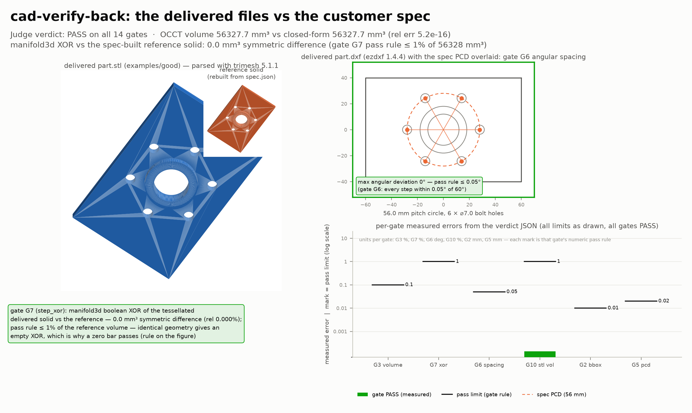
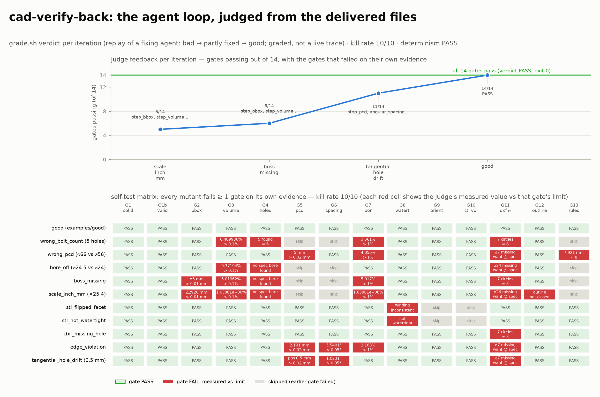

# cad-verify-back: mechanical CAD with CadQuery, judged from the delivered files

## Results





[`demo.mp4`](media/demo.mp4) — a turntable of the real delivered STL
(rendered offscreen, never a matplotlib animation), then full-frame cards of
the two figures above: the per-gate verdict against the spec, and the agent
loop with the mutant × gate kill matrix (34.7 s, 1920×1080, 30 fps, H.264).

Headline numbers from `grade.sh examples/good --json` (all 14 gates pass):

- OCCT volume 56 327.655 mm³ vs closed-form 56 327.655 mm³ (rel err 5.2×10⁻¹⁶)
- XOR symmetric difference vs the spec-built reference solid: 0.0 mm³
  (gate G7 pass rule ≤ 1% of 56 328.18 mm³)
- STL watertight, winding consistent, 8 104 faces; STL agrees with the
  STEP solid (volume rel err 2.3×10⁻⁶, bbox exact, XOR 3.6 mm³ ≪ 1%)
- angular spacing max deviation 0° vs the 0.05° rule; 8 DXF circles
- self-test kill rate **15/15** plus 2/2 pass-cases; determinism PASS
  (same seed → byte-identical verdict)


An agent designs an industrial adapter plate (plate + central bore + raised
boss + bolt circle) with **CadQuery 2.7.0** on OCCT from a customer spec JSON,
and delivers `part.step`, `part.stl` and `part.dxf`. A judge it cannot fool
then **verifies what was delivered, never the in-memory model**: it
re-imports the STEP through OCCT (solid count, `BRepCheck_Analyzer` B-rep
validity, bbox, volume vs a closed-form analytic volume, through-hole
count/diameters, bolt-circle PCD and angular spacing) and diffs it against a
reference solid rebuilt from the spec alone via a manifold3d boolean XOR
(≤ 1 % of the reference volume); it parses the STL with **trimesh**
(watertightness, winding consistency, volume), reads the DXF with ezdxf
(circle count/diameters/positions, outline), and checks the design rules
(minimum edge distance, minimum ligament) from the delivered geometry.
Nothing the agent exports can touch the judge's oracle.

Why a sandbox helps: the CAD toolchain (CadQuery/OCCT + GL runtime libraries)
is heavy and pinned; the agent installs it, iterates on its own geometry and
re-grades as often as it likes in a disposable environment, and the repo stays
clean of any of it.

## The one-command run

```bash
python3 run.py                # ref defaults to main; --ref <sha|branch> to override
```

Creates a sandbox, clones this repo, runs `judge/setup.sh`,
`judge/selftest.sh` and `judge/grade.sh examples/good`, prints the verdict
JSON + kill rate, then kills the sandbox (unless `--keep`). Needs the `sbx`
CLI and `SBX_API_KEY` (or `E2B_API_KEY`).

Measured wall time per step (2 vCPU sandbox, see RECEIPT.md for full output):

| step | wall time |
|---|---|
| `sbx create` | ~5 s |
| clone (depth 1) | ~5 s |
| `judge/setup.sh` (apt + 44 pinned wheels, ~300 MB) | ~2–4 min |
| `judge/selftest.sh` (good + 10 mutants + determinism) | ~5–7 min |
| `judge/grade.sh examples/good` | ~25 s |

Limits, stated plainly: the judge needs ~1.5 GB of RAM for the OCCT
re-import; grading a mutant that produces a huge STL would still finish but
the demo sizes parts in mm with meshes under ~1 MB. Setup dominates: the
pinned wheel set is ~300 MB to download once per sandbox. Nothing here is
parallelised; every gate is single-threaded and deterministic.

## Ask your agent (paste into a sandbox with this repo cloned)

> In `cookbook/cad-verify-back/`, read `SPEC.md` and the customer spec
> `judge/spec.json`. Using CadQuery 2.7.0 (already installed by
> `judge/setup.sh`; run it if `python3 -c "import cadquery"` fails), write
> `part.py` that builds the adapter plate exactly to that spec and exports
> `part.step`, `part.stl` (binary) and `part.dxf` (2-D top view: outline +
> CIRCLE per hole + boss OD) into your working directory. Then run
> `bash judge/grade.sh <your-directory>` and iterate on your own part.py
> until the verdict is `pass` with exit code 0. The judge only reads your
> three delivered files — it never runs your Python — and reports every
> measured vs expected number in its JSON. Do not modify anything under
> `judge/`; the judge checksums itself before and after grading.

A known-good `part.py` is in `examples/good/` (regenerate its exports with
`python3 examples/good/part.py`; they are gitignored).

## What the judge checks (full numeric rules in SPEC.md)

- **STEP** (re-imported through OCCT): 1 valid solid (`BRepCheck_Analyzer`);
  bbox ≤ 0.01 mm from spec; volume ≤ 0.1 % from the closed-form
  `l·w·t + boss annulus − bore − bolts`; `bolt_n + 1` cylindrical
  through-holes with diameters ≤ 0.01 mm; bolt centres on the PCD radius
  within 0.02 mm and at the analytic PCD angles within 0.05°; XOR
  symmetric-difference volume vs the spec-built reference solid ≤ 1 %.
- **STL** (trimesh): watertight with consistent winding; positive (outward)
  volume; agrees with the STEP solid — volume within 1 %, bbox within
  0.05 mm, XOR symmetric difference ≤ 1 % of the STEP volume.
- **DXF** (ezdxf): `bolt_n + 2` CIRCLEs with diameters/positions to spec;
  closed rectangular outline `plate_l × plate_w` centred on the origin.
- **Design rules**: min edge distance and min ligament ≥ spec (0.01 mm slack).

The self-test (`judge/selftest.sh`) regenerates 15 single-edit mutants
(wrong bolt count, wrong PCD, bore +0.5 mm, boss missing, inch/mm ×25.4,
STL with one reversed facet, STL with one dropped facet, DXF missing a
hole, edge-distance violation, one bolt hole drifted 0.5 mm along the PCD
— STEP and DXF agree on the drift, so the kill is shared between the
angular-spacing and DXF-circle gates — a bow-tie outline, a bulged
outline, an equal-volume box STL, and one hole 0.1 mm along the PCD with
the DXF kept at spec positions, which must fail **only** the
angular-spacing gate), requires every one to fail at least one **named**
gate — kill rate 15/15 = 100 % — and re-grades pass-cases that must
survive (a 4-LINE rectangle; the outline shifted 0.005 mm, inside the
0.01 mm rule). It prints every failing gate per mutant.

## Third-party sources

- CadQuery 2.7.0, Apache-2.0, https://github.com/CadQuery/cadquery
- OCCT via `cadquery-ocp` 7.8.1.1.post1, Apache-2.0, https://github.com/CadQuery/OCP
- ezdxf 1.4.4, MIT, https://github.com/mozman/ezdxf
- trimesh 5.1.1, MIT, https://github.com/mikedh/trimesh
- manifold3d 3.5.4, Apache-2.0, https://github.com/elalish/manifold
- the good `part.py` was written for this demo; no third-party geometry files
  are used

Media (result figure, agent-loop figure, demo video) lives in `media/` and is
regenerated from real judge output by `bash media/make_media.sh` (see
`media/MANIFEST.json` for sources and sha256).
