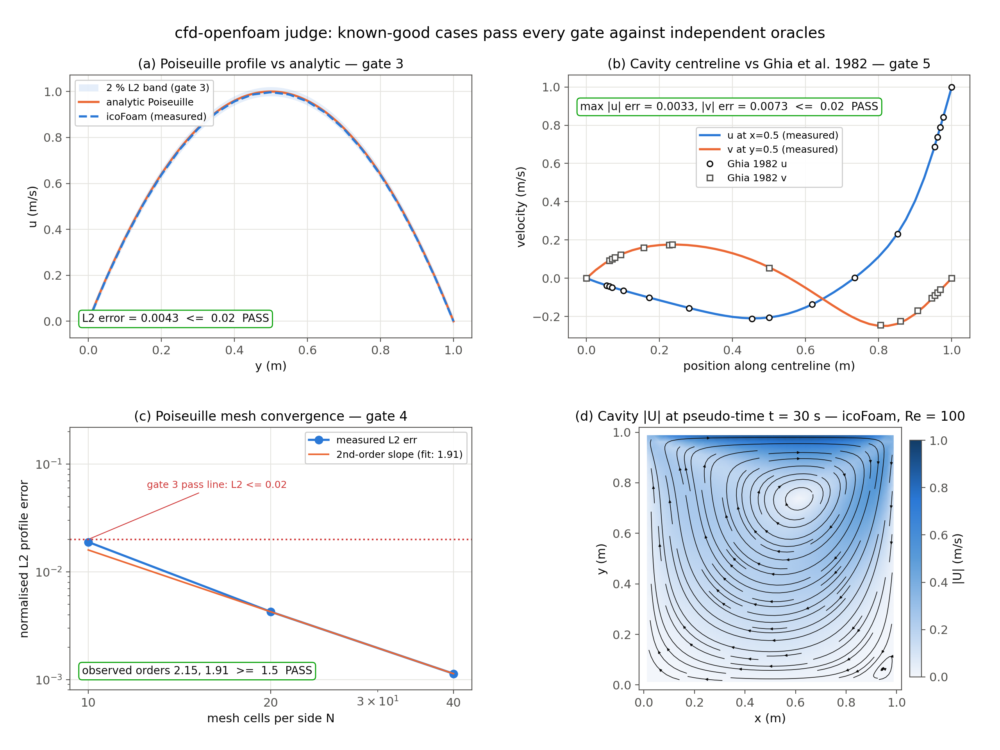
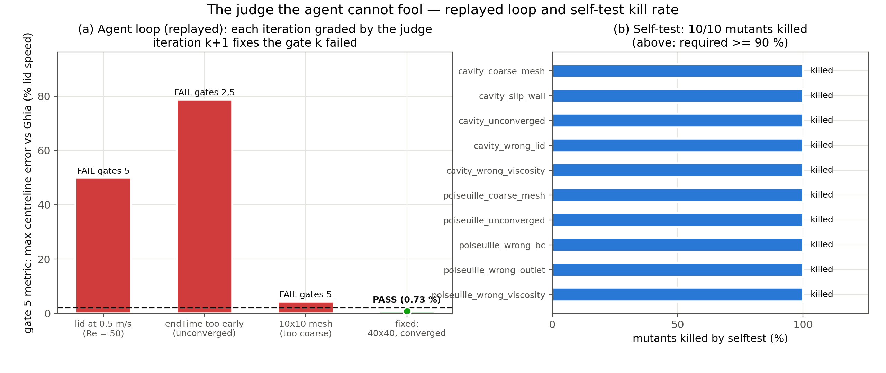

# CFD with OpenFOAM — channel Poiseuille + lid-driven cavity

A disposable agent-next sandbox installs a pinned, sha256-checked OpenFOAM
v1912 (Debian bookworm packages) and runs two classic incompressible-flow
benchmarks with `icoFoam`: plane Poiseuille channel flow at Re = 100 and the
lid-driven cavity at Re = 100. A judge it cannot fool decides correctness:
the channel profile is compared to the analytic parabola (plus pressure
gradient and a mesh-refinement convergence check), and the cavity
centreline velocities are compared to the tabulated data of Ghia, Ghia &
Shin (1982). A sandbox helps because OpenFOAM is a heavy, system-level
toolchain (~600 MB of packages) that you can install, run and throw away
without touching your own machine.

The artifact under test is an OpenFOAM case directory — `0/`, `constant/`,
`system/` input files only. The judge copies it to scratch, runs
`blockMesh`, `checkMesh`, `icoFoam` and `postProcess` itself, and never
lets shipped results stand in for a real run. Gates and thresholds are in
[SPEC.md](SPEC.md); measured results and real command output are in
[RECEIPT.md](RECEIPT.md).

## Results





▶ **[media/demo.mp4](media/demo.mp4)** — continuous tracer advection
through the actual graded OpenFOAM velocity fields, with fixed views of the
cavity, driven lid and return flow. A Remotion HUD shows physical time and
measured gate-5 errors while the flow keeps moving; only the final two-second
launch card is static. Media is regenerated from live judge output by
[`media/make_media.sh`](media/make_media.sh); provenance is recorded in
[media/MANIFEST.json](media/MANIFEST.json). The tracers visualize interpolated
solver output; they do not introduce an additional accuracy claim. The verdict
HUD reports the final graded case at solver time 30 s, while the playback
clock labels the earlier evolving flow.

- Poiseuille profile error **L2 = 0.0043** vs the analytic parabola — gate 3
  pass line 0.02.
- Mesh convergence observed orders **2.15, 1.91** (gate 4 requires ≥ 1.5).
- Cavity centreline max error vs Ghia et al. 1982: **u 0.0033, v 0.0073** —
  gate 5 pass line 0.02.
- All residuals **< 1e-5** at endTime, max continuity error < 1e-8 (gate 2).
- Self-test kills **10/10** known-bad mutants (gate rule: ≥ 90 %, ≥ 5
  mutants).

## Ask your agent

> Create a CPU sandbox. In it, clone https://github.com/agent-next/sandbox
> and run `bash cookbook/cfd-openfoam/judge/setup.sh` to install the pinned
> OpenFOAM. Then build a case directory for the lid-driven cavity at
> Re = 100 (unit square, lid speed 1 m/s, icoFoam) and iterate with
> `bash cookbook/cfd-openfoam/judge/grade.sh <your-case-dir>` until every
> gate passes. Do the same for a plane-Poiseuille channel case (fully
> developed parabolic inlet, Re = 100). Report the final verdict JSON and
> kill the sandbox when done.

## One-command run (with sandbox API)

```bash
export SBX_API_KEY=<your key>
pip install "git+https://github.com/agent-next/sandbox#subdirectory=cli"
python3 cookbook/cfd-openfoam/run.py          # add --ref <branch> or --keep
```

`run.py` creates a sandbox, clones this repo at `--ref` (default `main`),
runs `judge/setup.sh`, `judge/selftest.sh`, then grades both known-good
cases, prints the verdict JSON, and kills the sandbox (verifying it is
gone) unless `--keep` is given.

## In-sandbox / no API key (run directly inside any Debian 12 box)

If you already have a Debian 12 (bookworm) environment with 2 vCPU and
~4 GB RAM — or you are inside the sandbox created by another tool — you
can run the judge steps directly without `SBX_API_KEY` or `run.py`:

```bash
# Prerequisites
sudo apt-get update && sudo apt-get install -y ffmpeg
python3 -m venv /tmp/ofmedia && /tmp/ofmedia/bin/pip install \
    --require-hashes -r judge/requirements.txt

# 1. Install pinned OpenFOAM (needs passwordless sudo for apt)
bash judge/setup.sh

# 2. Self-test: proves the judge can fail (runs 2 good + 10 mutants)
bash judge/selftest.sh

# 3. Grade the known-good cases (seed 42 for reproducibility)
bash judge/grade.sh examples/good/poiseuille --json /tmp/verdict_poiseuille.json --seed 42
bash judge/grade.sh examples/good/cavity     --json /tmp/verdict_cavity.json     --seed 42
```

### `judge/grade.sh` flags

| flag | purpose | example |
|---|---|---|
| `--json FILE` | write verdict JSON to `FILE` | `--json /tmp/v.json` |
| `--seed N` | seed recorded in verdict JSON (does not affect solver) | `--seed 42` |
| `--trace DIR` | write per-step solver traces (residuals, profiles, time dirs) to `DIR` | `--trace /tmp/traces` |

The seed is only recorded in the verdict JSON for reproducibility
tracking; the judge itself is deterministic at any fixed seed. The
`--trace` directory is used by `media/make_media.sh` to build the video
and figures.

### Prerequisites

- **Debian 12 (bookworm)** — the pinned OpenFOAM packages are from this
  release.
- **passwordless `sudo`** — `judge/setup.sh` calls `apt-get install`.
- **Node.js 18+ and npm** — media composition installs pinned Remotion
  4.0.280 and React 18.3.1 in a temporary directory and removes it on exit.
  Set `CHROME_EXECUTABLE` to reuse an installed headless Chromium.
- **`ffmpeg`** — required by `media/make_media.sh` for video encoding
  (pinned version recorded in `judge/VERSIONS.txt`).
- **Python 3.11+** with the **pinned media venv** — install via:
  ```bash
  python3 -m venv /tmp/ofmedia && /tmp/ofmedia/bin/pip install \
      --require-hashes -r judge/requirements.txt
  ```
  Then run media with `PYTHON=/tmp/ofmedia/bin/python bash media/make_media.sh`.

## Measured wall times (2 vCPU, Debian bookworm)

| step | wall time |
|---|---|
| `judge/setup.sh` (cold) | ~16–23 s (packages cached regionally; ~2–4 min worst case) |
| `judge/selftest.sh` (2 good + 10 mutants) | 54–73 s |
| `judge/grade.sh examples/good/poiseuille` | ~6 s |
| `judge/grade.sh examples/good/cavity` | ~6 s |

## Sources

- Ghia, U., Ghia, K.N., Shin, C.T. (1982), "High-Re solutions for
  incompressible flow using the Navier-Stokes equations and a multigrid
  method", *J. Comput. Phys.* 48(3), 387-411 — Tables I & II, Re = 100;
  tabulated values reproduced in `judge/check_gates.py`.
- The case layout follows the upstream OpenFOAM `icoFoam` cavity tutorial
  shipped in `openfoam-examples` 1912.200626-1 (GPL-3.0,
  https://openfoam.org/); the case files here were written for this demo.

## Independent reproduction

The original judge metrics were independently reproduced — see
[REPRODUCE.md](REPRODUCE.md).

## Limits

- Single-core `icoFoam` only; no MPI, no turbulence, no snappyHexMesh.
- Gates pin Re = 100 and the unit-square geometry of SPEC.md — a case
  solving a different Re fails even if physically self-consistent.
- Ghia reference data is a 129x129 benchmark; the tolerance (0.02 of the
  lid speed) reflects a 40x40 mesh, not solver-exact agreement.
