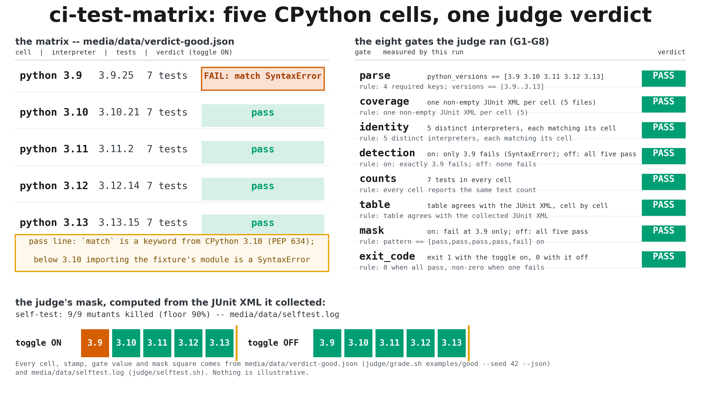
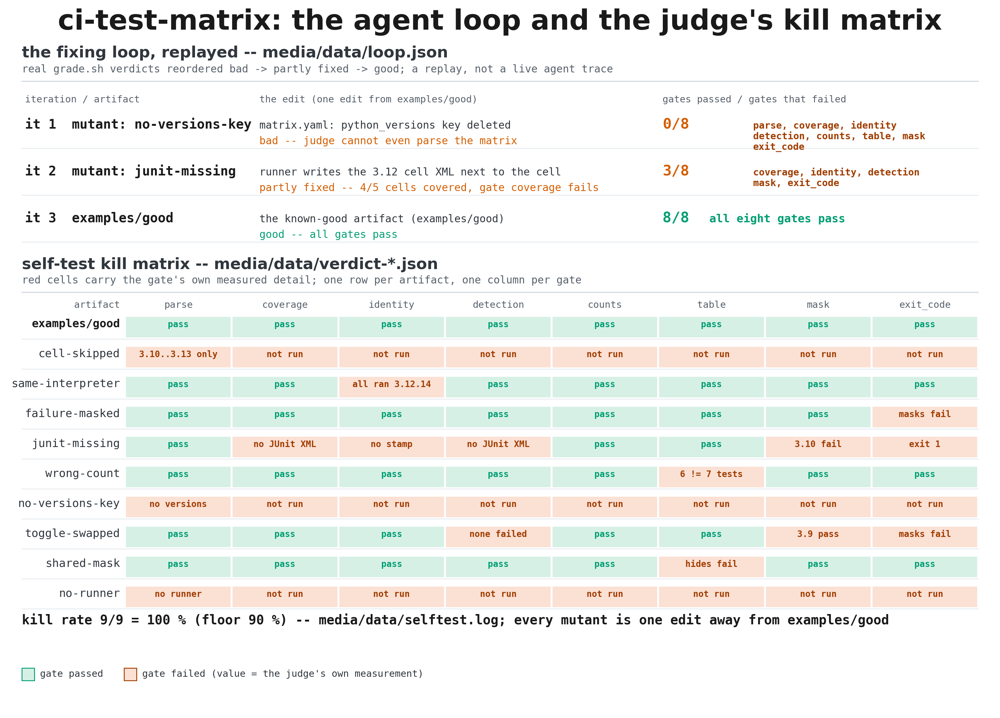

# ci-test-matrix — a test matrix across Python versions, graded by a judge

An agent has to *build* a CI primitive, not just run a test suite: produce a
`matrix.yaml` plus a `run_matrix.py` that runs one pinned library's pytest
suite across five CPython versions (3.9, 3.10, 3.11, 3.12, 3.13) — one
disposable sandbox cell per version, uv-managed interpreters — collects a
JUnit XML file per cell, aggregates them into a pass/fail matrix table, and
detects the fixture's deliberately version-specific failure: a module using
`match` syntax, which is a `SyntaxError` on Python 3.9 and below. The judge is
not "it ran": the verdict is checked against an independent oracle (the
Python language specification — `match` becomes a keyword in 3.10), a
measured per-cell interpreter-identity stamp, and an exit-code gate, so a
runner that silently skips a cell, reuses one interpreter, or masks a failure
cannot pass. A disposable sandbox is the right place for this: the agent
needs five real interpreters, a throwaway filesystem per cell to iterate in,
and the graded artifact is two small files it hands back.

## Results





[▶ demo.mp4](media/demo.mp4) — 40 s: the matrix table filling in cell by
cell → the 3.9 failure detected → the aggregated table against the expected
mask → the agent-loop replay → the self-test kill-rate bars (1920×1080,
H.264, < 8 MB)

Key numbers from the judge verdict (`examples/good/`, toggle on):

- **Failing cell**: exactly `3.9` (the `match`-syntax `SyntaxError`), the
  other four pass
- **Test count per cell**: 6 (identical on every version)
- **Interpreter identity**: 3.9.25, 3.10.21, 3.11.16, 3.12.14, 3.13.15 —
  five distinct interpreters, each matching its cell
- **Exit codes**: 0 with the toggle off, 1 with the toggle on
- **Self-test kill rate**: 9/9 = 100 % (requirement ≥ 90 %)

## Ask your agent

> Set up a sandbox and solve the demo in `cookbook/ci-test-matrix/` of
> https://github.com/agent-next/sandbox (clone it first). Run
> `bash cookbook/ci-test-matrix/judge/setup.sh`, read
> `cookbook/ci-test-matrix/SPEC.md`, then design the artifact yourself: a
> `matrix.yaml` naming the cells, the fixture, the toggle and the JUnit
> directory, plus a `run_matrix.py` that runs the fixture suite under each
> version in its own uv-managed interpreter, writes one JUnit XML file per
> cell, aggregates them into a matrix table, and exits non-zero when any
> cell fails. Iterate with
> `bash cookbook/ci-test-matrix/judge/grade.sh <your-dir> --json v.json`
> until it exits 0, then paste the final verdict JSON. Do not edit anything
> under `judge/`; if you believe the judge is wrong, say so instead of
> working around it. Kill the sandbox when you are done.

The known-good example in `examples/good/` is a hand-written runner that
shells out to `uv` and `pytest`; a working answer does not have to be.

## One-command run

```bash
pip install "git+https://github.com/agent-next/sandbox#subdirectory=cli"
export SBX_API_KEY=<your key>
python3 cookbook/ci-test-matrix/run.py          # --ref main --keep supported
```

Creates a sandbox, clones the repo, installs pinned tools, runs the judge
self-test, grades `examples/good/`, prints the verdict JSON, then kills the
sandbox and confirms it is gone. Stdlib only; exits non-zero on any failure,
naming the sandbox id if cleanup cannot be confirmed.

## Measured wall time (Debian sandbox, 2 vCPU)

| step | wall time |
|---|---|
| `git clone --depth 1` | ~1 s |
| `judge/setup.sh` (fresh install) | 3.2 s (idempotent re-run: 0.1 s) |
| `judge/selftest.sh` (good + 9 mutants + determinism) | ~60 s |
| `judge/grade.sh examples/good/` | ~30 s |

Whole run, including sandbox create and kill: a few minutes; grading itself is
tens of seconds. `run.py` prints a per-step timing line.

## Limits, plainly

- The fixture is hand-written and pinned: 6 tests, pure stdlib, with one
  deliberately version-specific failure (`match` syntax, a `SyntaxError`
  below 3.10). Real package installation from PyPI is out of scope — only
  the one pinned, hash-checked `pytest` wheel set is installed per cell.
- Interpreters are the exact CPython patches `3.9.25`, `3.10.21`,
  `3.11.16`, `3.12.14`, `3.13.15`, uv-managed (see SPEC.md); a base image
  without those downloads needs network access for `uv`.
- The judge grades what SPEC.md grades: the five gates plus the exit-code
  gate. Parallelism, caching and reporting style beyond a machine-parseable
  YAML table are not rewarded.
- `uv` needs to download the five interpreters and the pinned wheels on a
  fresh machine; that is the one network dependency, sha256-checked on the
  `uv` binary and hash-checked on every wheel.
