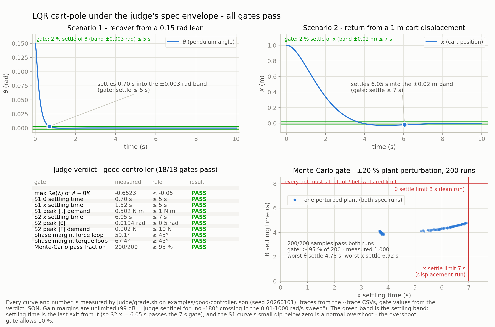
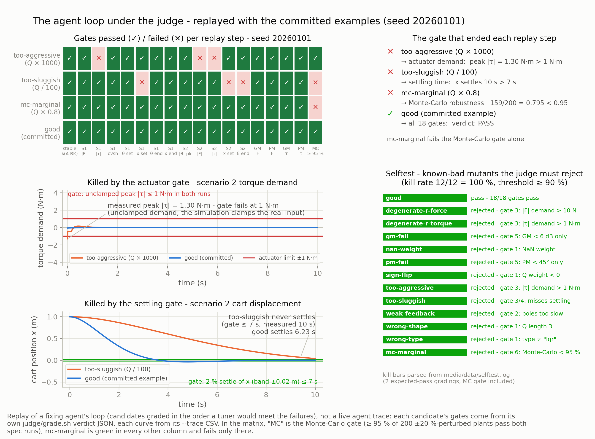

# Control tuning (inverted pendulum LQR)

An agent designs an LQR controller — it only picks the cost weights `Q` and
`R` — for an inverted pendulum on a cart, and a judge it cannot fool decides
whether the closed loop actually works: stability, 10 % overshoot,
settling-time and steady-state specs in nonlinear simulations with hard
actuator limits (±10 N, ±1 N·m), ≥ 6 dB / 45° loop-at-a-time margins, and
≥ 95 % of 200 Monte-Carlo runs staying stable with the plant masses and
geometry perturbed ±20 %. The sandbox matters because the search for weights
is iterative trial-and-error against a fixed grader: the agent burns CPU on
simulations, fails against the judge repeatedly, and never touches the
machine grading it — the artifact is two JSON arrays.

## Results

| | |
|---|---|
| **result.png** |  |
| **loop.png** |  |
| **demo.mp4** | [52 s MuJoCo replay of the judged trajectories](media/demo.mp4) (1920×1080, H.264, 5.2 MB) |

Key numbers from the judge verdict (seed 20260101, all 18 gates pass):
- Scenario 1 θ settles in **0.70 s** (gate ≤ 5 s), overshoot **0 %** (gate ≤ 10 %)
- Scenario 2 x settles in **6.05 s** (gate ≤ 7 s), peak |θ| **0.019 rad** (gate ≤ 0.5 rad)
- Actuator demands: |F| ≤ **0.90 N** (limit 10 N), |τ| ≤ **0.50 N·m** (limit 1 N·m)
- Phase margins: force **59.1°**, torque **67.4°** (both ≥ 45°)
- Monte-Carlo: **200/200** perturbed plants pass (gate ≥ 95 %)

From this repository's root, with Python 3.10 or newer (no extra packages
on the host), the `sbx` CLI and `SBX_API_KEY` in the environment:

```bash
export SBX_API_KEY=<your key>
python3 cookbook/control-tuning/run.py
```

The script creates a sandbox, clones this repo at `--ref` (default `main`),
runs `judge/setup.sh`, `judge/selftest.sh` and `judge/grade.sh` on the good
example inside it, prints the verdict JSON, and kills the sandbox even on
failure (`--keep` leaves it up for exploration instead). Measured wall times
from the receipt run (`RECEIPT.md`): setup ≈ 25 s, selftest (9 gradings)
≈ 90 s, grade with the 200-run Monte-Carlo ≈ 26 s, plus clone/create
overhead — a few minutes total.

Limits, stated plainly: the judge grades only `examples/good/controller.json`
as committed — it does not invite the agent to design anything during
`run.py`; the design loop is what the "Ask your agent" prompt below is for.
The plant model is textbook-linearised plus full nonlinear verification, with
no friction, no sensor noise, no quantisation, and full state feedback
assumed (no observer). Margin gates are loop-at-a-time SISO analyses of a
MIMO design — standard for LQR, but not a full multi-loop margin proof. The
Monte-Carlo gate is 200 deterministic samples, not a proof of robustness.

With the plugin, ask your agent:

> Create an agent-next sandbox. In it, read cookbook/control-tuning/SPEC.md,
> then design an LQR controller for the inverted-pendulum plant it
> specifies: write your candidate weights to
> cookbook/control-tuning/artifact.json (same JSON shape as
> examples/good/controller.json) and check it with
> `bash cookbook/control-tuning/judge/grade.sh cookbook/control-tuning/artifact.json --json /tmp/verdict.json`
> (run `cookbook/control-tuning/judge/setup.sh` once first). Iterate on the
> weights until every gate passes, including the 200-run Monte-Carlo — but
> do not edit anything under cookbook/control-tuning/judge/ or copy the
> example gains; the judge must earn the pass. Then run
> `bash cookbook/control-tuning/judge/selftest.sh`, paste the verdict JSON
> and the kill rate, kill the sandbox, and confirm it is gone.

`SPEC.md` has the exact gates and thresholds; `RECEIPT.md` has real output
from a sandbox-shaped run of every command.
