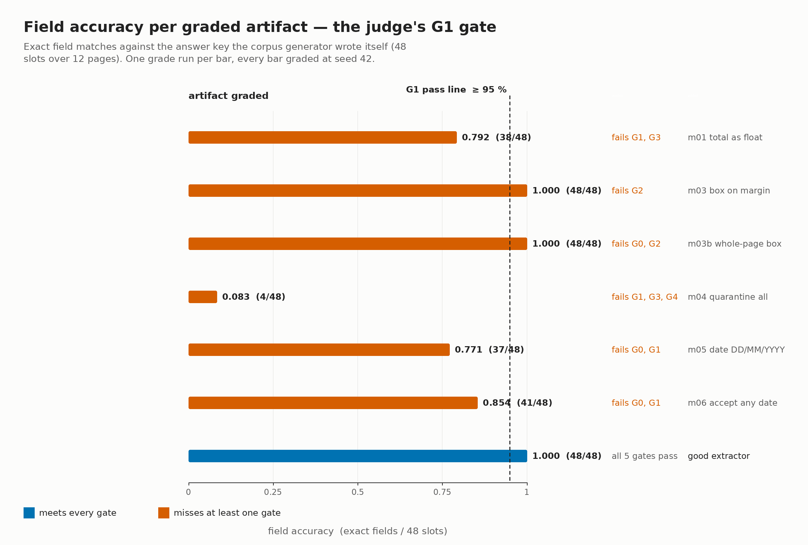

# Ugly documents → grounded JSON (doc-extract-convert)

A disposable agent-next sandbox turns a pile of 12 mixed-format scanned
invoices — structured record blocks, three layout families, three raster
degradations (skew, scanner dust, faded photocopy) — into clean structured
JSON where **every field carries the page-region it was read from**, and
documents the extractor is not sure about are **quarantined with a reason
code instead of guessed**. A judge it cannot fool decides correctness: it
re-derives the ground truth from the corpus generator itself (never from
any OCR step), requires ≥ 95 % exact field accuracy over all 48 slots,
re-measures the page raster to check every claimed bounding box really
sits on ink, and feeds the extractor a corrupted corpus (a blank page and
a scanner smear) that must come back quarantined — never invented. A
sandbox helps because the OCR toolchain (tesseract 5.3.0 + Pillow 11.3.0,
sha256-checked) is installed, run and thrown away without touching your
own machine, and the whole grade — two full corpus runs — finishes in
about a minute on 2 vCPU.

A 27-second video of the same run is at
[media/demo.mp4](media/demo.mp4); the agent loop and the self-test kill
rate are in [media/loop.png](media/loop.png).  Regenerate every media file
with `bash media/make_media.sh` (~15 min: it re-grades all seven artifacts).

The artifact under test is an **extractor**: a directory with an
`extract.py` the judge invokes as
`python3 extract.py --in <pages_dir> --out <out_dir>`, which must write
`records.json` + `quarantine.json` per [SPEC.md](SPEC.md). The judge
copies it to scratch, regenerates the corpus at the requested seed from
`judge/fixtures.py`, and never lets shipped results stand in for a real
run. Gates and numeric thresholds are in [SPEC.md](SPEC.md); measured
results and real command output are in [RECEIPT.md](RECEIPT.md); the
independent reproduction protocol is in [REPRODUCE.md](REPRODUCE.md).

## Results

- Field accuracy **48/48 = 100 %** (gate line ≥ 95 %) at seed 42.
- **11/11** reported totals exact to 0 ulp as 2-decimal strings.
- Every claimed bbox grounded on ink (0 failures, adaptive per-page
  binarisation).
- Negative control: **2/2** corrupted pages (blank + smear) quarantined
  with the right reason codes, **0 invented values**, 12/12 pages
  accounted for across both files.
- Self-test kills **6/6** known-bad mutants plus one judge-guard mutant
  (rule: ≥ 90 %, ≥ 5 mutants).



*The figure is `media/result.png`, regenerated by `media/make_media.sh`
from the verdict JSONs `judge/grade.sh` writes — one bar per graded
artifact, the dashed line is the ≥ 95 % rule. See
[media/MANIFEST.json](media/MANIFEST.json) for the command and seed behind
each number.*

## Ask your agent

> Create a CPU sandbox. In it, clone
> https://github.com/agent-next/sandbox and run
> `bash cookbook/doc-extract-convert/judge/setup.sh` to install the
> pinned OCR toolchain. Then write your own extractor: a directory with an
> `extract.py` that takes `--in <pages_dir> --out <out_dir>` and writes
> `records.json` (one grounded record per readable page: vendor,
> invoice_no, date, total — each with a page-pixel bounding box and a
> confidence) and `quarantine.json` (one entry per page you are below
> 90 % sure about, with a reason code: LOW_CONFIDENCE, NO_TEXT,
> MALFORMED_FIELD or UNREADABLE_PAGE). Generate the corpus with
> `python3 judge/fixtures.py --seed 42 --out /tmp/corpus` and iterate with
> `bash cookbook/doc-extract-convert/judge/grade.sh <your-extractor-dir>`
> until every gate passes. Read SPEC.md first for the exact output
> format. Report the final verdict JSON and kill the sandbox when done.

## One-command run (with sandbox API)

```bash
export SBX_API_KEY=<your key>
pip install "git+https://github.com/agent-next/sandbox#subdirectory=cli"
python3 cookbook/doc-extract-convert/run.py          # add --ref <branch> or --keep
```

`run.py` creates a sandbox, clones this repo at `--ref` (default `main`),
runs `judge/setup.sh`, `judge/selftest.sh`, then grades the known-good
artifact, prints the verdict JSON, and kills the sandbox (verifying it is
gone) unless `--keep` is given.

## In-sandbox / no API key (run directly inside any Debian 12 box)

If you already have a Debian 12 (bookworm) environment with 2 vCPU and
~4 GB RAM — or you are inside the sandbox created by another tool — you
can run the judge steps directly without `SBX_API_KEY` or `run.py`:

```bash
# 1. Install the pinned, sha256-checked toolchain (needs passwordless
#    sudo for apt; tesseract 5.3.0, DejaVu fonts, Pillow 11.3.0)
bash judge/setup.sh

# 2. Self-test: proves the judge can fail (6 single-edit mutants + a
#    judge-guard mutant + a determinism check)
bash judge/selftest.sh

# 3. Grade the known-good artifact (seed 42)
bash judge/grade.sh examples/good --json /tmp/v.json --seed 42
```

### `judge/grade.sh` flags

| flag | purpose | example |
|---|---|---|
| `--json FILE` | write verdict JSON to `FILE` | `--json /tmp/v.json` |
| `--seed N` | corpus seed (recorded in verdict JSON) | `--seed 42` |

Every random choice in the corpus, the corruption and the grading takes
the seed (default 42); two grading runs at the same seed are
byte-identical apart from the `timing` key (checked by `selftest.sh`).

### Prerequisites

- **Debian 12 (bookworm)** — the pinned tesseract/font packages are from
  this release.
- **passwordless `sudo`** — `judge/setup.sh` calls `apt-get install`.
- **python3.10+** with pip (Pillow 11.3.0 installs into `~/.local`).

### Corpus provenance

The corpus is **generated locally by a seeded script**
(`judge/fixtures.py`) — every page is rendered from a seeded record list
with Pillow and the pinned DejaVu fonts, and the answer key
(`judge/truth.json` + `judge/corpus.sha256`) is written by the generator
in the same pass. No third-party document is shipped, so no third-party
licence applies to the corpus.
