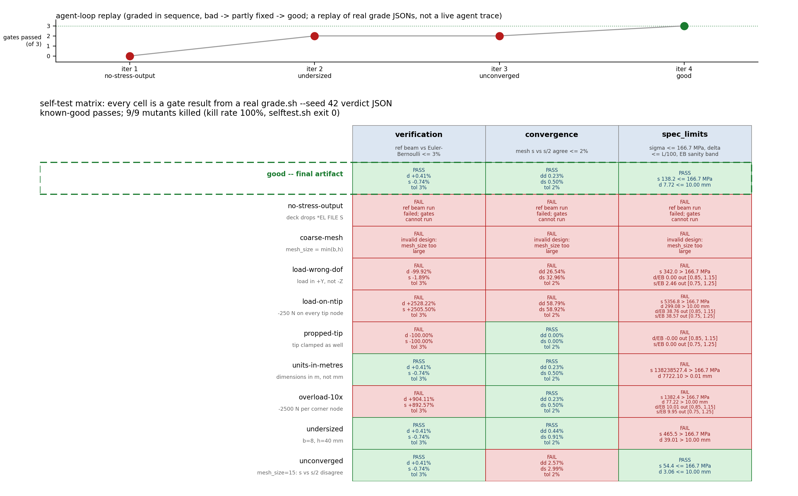

# fea-calculix — cantilever beam sizing with CalculiX in a sandbox

An agent designs a steel cantilever beam inside a disposable agent-next
sandbox: it picks the cross-section, writes a CalculiX deck, and iterates
until the judge passes. The judge meshes the beam with gmsh, solves it with
`ccx`, and checks the numbers against Euler-Bernoulli beam theory — it
cannot be fooled by a solver that merely ran.

Fixed spec: 1000 N tip load, E = 200 GPa steel, allowable stress
250/1.5 = 166.7 MPa, tip deflection <= L/100, minimise mass. Units mm/N/MPa.

## Results




[media/demo.mp4](media/demo.mp4) — 33 s: the real displacement field
ramped 0 → 1000 N, then each mutant's failing gate.

Numbers below are from `media/data/verdicts/good.json`
(`judge/grade.sh examples/good --seed 42`) and `media/data/selftest.txt`:

- verdict **PASS** for `examples/good`: sigma_wall 138.2 ≤ 166.7 MPa,
  tip deflection 7.72 ≤ 10.00 mm, mass 5652 g
- verification vs Euler-Bernoulli (reference beam): +0.41 % deflection /
  −0.74 % stress (tolerance 3 %)
- mesh convergence 4 mm → 2 mm (11250 → 60000 elements): 0.23 %
  deflection / 0.50 % stress change (tolerance 2 %)
- self-test: 9/9 mutants killed (100 %); two `--seed 42` grades
  byte-identical excluding the `timing` key

## Ask your agent

> Clone https://github.com/agent-next/sandbox into this sandbox and run
> `bash cookbook/fea-calculix/judge/setup.sh` (installs CalculiX `ccx` and
> gmsh under `~/tools/bin`). Design the lightest cantilever beam for the
> spec in `SPEC.md`: produce `artifact/design.json` (`L`, `b`, `h`,
> `mesh_size` in mm) and `artifact/beam.inp` (deck contract in SPEC.md —
> include `mesh.inc`, clamp `NFIX`, apply 250 N downward on each `NLOAD`
> corner node, request `U` and `S` output). Then run
> `judge/grade.sh artifact` and iterate until it prints `"PASS"`.

## One-command run

```bash
python3 run.py            # clones this repo at main into a fresh sandbox
python3 run.py --ref my-branch --keep
```

Needs the `sbx` CLI (`pip install "git+https://github.com/agent-next/sandbox#subdirectory=cli"`)
and `SBX_API_KEY` in the environment. It creates a sandbox, clones the repo,
runs `judge/setup.sh`, `judge/selftest.sh`, and `judge/grade.sh
examples/good`, prints the verdict JSON, and kills the sandbox.

Without the `sbx` CLI or a key, run the same steps inside any Debian 12 box:

```bash
bash judge/setup.sh
bash judge/selftest.sh
bash judge/grade.sh examples/good --seed 42
```

The media is rebuilt by `bash media/make_media.sh` after `judge/setup.sh`
(it re-solves the displayed fields with ccx and reads the committed verdicts;
needs ffmpeg). `media/MANIFEST.json` records the sha256 of every output; an
independent rebuild matched it byte for byte (`REPRODUCE.md`).

Measured on a 2 vCPU / 4 GB sandbox (see RECEIPT.md):

| step | wall time |
|---|---|
| setup (pinned .deb files + gmsh tarball, all sha256-checked) | ~15 s |
| selftest (good + 9 mutants + determinism check) | ~5 min |
| grade the good artifact | ~35 s |

## How the judge works

- `judge/setup.sh` — installs `calculix-ccx` 2.20-1 and its solver
  libraries (spooles, arpack) from sha256-pinned Debian bookworm `.deb`
  files, and gmsh 4.10.0 from a sha256-pinned official tarball, into
  `~/tools`.
- `judge/grade.sh <artifact>` — meshes `mesh_size` and `mesh_size/2` with
  gmsh, runs the deck under `ccx`, prints a JSON verdict:
  verification vs Euler-Bernoulli on a reference beam (<= 3%), mesh
  convergence on the design (<= 2%), the spec limits, and the mass.
  Wall time lives under a `timing` key; everything else is deterministic
  (two runs with the same seed are byte-identical).
- `judge/selftest.sh` — the good artifact must pass, >= 90% of the
  scripted mutants (`judge/mutants.py`) must fail (each kill line and
  the kill rate are printed), and grading the good artifact twice with
  the same seed must give identical JSON except `timing`.
  The 9 mutants and the gate that kills each are documented in
  `examples/bad/README.md`.
- The artifacts under test are plain data (JSON + `.inp`); selftest also
  checksums `judge/` before and after grading.

## Limits

- Linear-elastic, static, slender beams only (`L >= 5*max(b,h)`).
- Stress is evaluated away from the clamped-face singularity (see SPEC.md);
  the pointwise stress at the wall corner is singular and intentionally
  not the measured quantity.
- One grading run is three `ccx` solves of <= ~150k elements — minutes,
  not hours, by construction.
