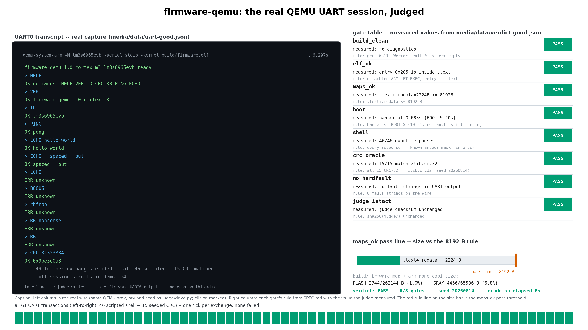
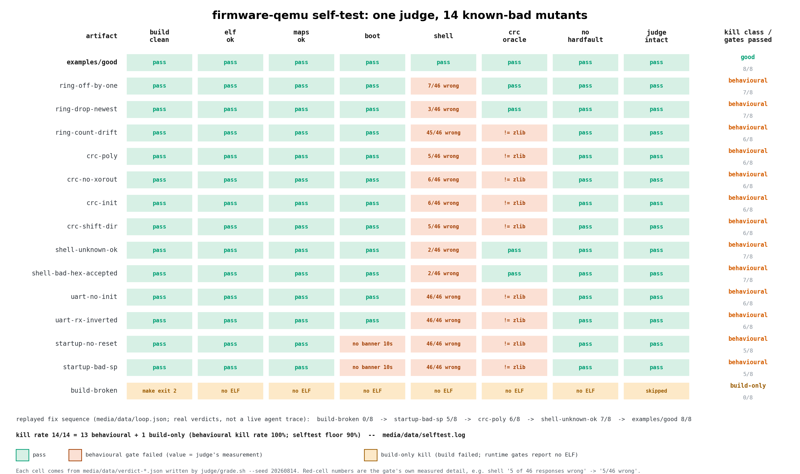

# firmware-qemu — bare-metal UART shell on an emulated Cortex-M3

An agent writes real embedded C — no OS, no libc, hand-written linker
script and startup code — for a Stellaris LM3S6965 EVB board that exists
only inside QEMU. The firmware must build warning-free, boot on the
emulator, and answer a scripted UART command shell. A judge it cannot
fool decides whether the result is right: every gate compares the
firmware against an independent oracle (the Arm toolchain, `readelf`,
Python's `zlib.crc32`, a known-answer response mask, and checksums of the
judge itself), not against the agent's own claims.

A disposable sandbox is what makes this honest: the toolchain, the
emulator and the firmware under test are all installed from nothing on a
machine the agent does not control, and the whole thing is thrown away
afterwards. Nothing about the host leaks into the verdict.

## Results

[](media/result.png)
[](media/loop.png)

[demo.mp4](media/demo.mp4) replays the real captured UART session, then
runs the `crc-poly` mutant with the oracle-divergent responses
highlighted, then the verdicts. Every number in the figures comes from a
judge output file in `media/data/` (`grade.sh --seed 20260814`,
`selftest.sh`). To rebuild them, regenerate the data first —
`media/make_media.sh` refuses to render from missing inputs:

```
bash media/collect_data.sh   # re-runs judge, mutants, selftest, UART captures (~8.5 min)
bash media/make_media.sh     # figures + video; rewrites MANIFEST.json
```

`make_media.sh` needs `ffmpeg` and `ffprobe` (e.g. `apt install ffmpeg`)
plus the pinned Python package in `media/requirements.txt`
(`pip install -r media/requirements.txt`, or let the script install it
into `media/.venv` itself). `result.png` and `demo.mp4` embed
wall-clock values — the grade's elapsed seconds and the UART capture's
timing — so a fresh capture changes them by a few bytes, while
`loop.png` and every verdict in `media/data/` reproduce byte-identically
(`REPRODUCE.md` proves this).

- `examples/good` passes **8/8 gates**: **46/46** scripted shell
  responses byte-exact, **15/15** seeded CRC-32 buffers match
  `zlib.crc32`, boot banner at 0.085–0.141 s across hosts
  (host-dependent; limit 10 s).
- `.text+.rodata` = **2224 B** against the 8192 B `maps_ok` limit;
  the build's memory map reports FLASH 2744/262144 B, SRAM 4456/65536 B.
- The self-test kills **14/14** mutants — 13 by behavioural gates
  (`boot`/`shell`/`crc_oracle`), 1 build-only; behavioural kill rate
  **100 %** (floor: 90 %).

**Ask your agent:** "Write bare-metal firmware for a QEMU `lm3s6965evb`
board (Cortex-M3, UART0) that boots and serves the command shell in
`cookbook/firmware-qemu/SPEC.md`. The judge will build it with
`-Wall -Werror` and interrogate it over the emulated UART."

## Run it

```
pip install "git+https://github.com/agent-next/sandbox#subdirectory=cli"
export PATH="$HOME/.local/bin:$PATH"   # pip --user installs sbx here
export SBX_API_KEY=<your key>          # or E2B_API_KEY
python3 run.py                         # --ref <branch> to clone a ref
```

A `pip --user` install puts the `sbx` console script in `~/.local/bin`,
which is not on `PATH` everywhere — add it or `run.py` reports
"sbx CLI not found". `SBX_API_KEY` (or `E2B_API_KEY`) is required;
without it `run.py` exits immediately. `run.py` creates a disposable
sandbox, clones this repo, installs the pinned toolchain, proves the
judge on the known-good and known-bad artifacts, grades
`examples/good/`, prints the verdict JSON, then kills the sandbox and
confirms it is gone. `--keep` leaves the sandbox up.

**No sandbox credentials?** The three judge steps `run.py` runs inside
the sandbox work verbatim on any Debian 12 box. From this directory:

```
bash judge/setup.sh
bash judge/selftest.sh
bash judge/grade.sh examples/good --seed 20260814
```

`20260814` is the seed every figure, verdict and reproduction here uses
(it is also `grade.sh`'s built-in default).

Measured wall time per step (see `RECEIPT.md` for the full record):

| step | wall time |
|---|---|
| create sandbox | ~2 s |
| clone repo | ~3 s |
| `judge/setup.sh` (toolchain + QEMU, sha256-checked) | ~140–385 s |
| `judge/selftest.sh` (good + 14 mutants + determinism) | ~120–255 s |
| `judge/grade.sh examples/good` | ~7 s |

`setup.sh` may print `sudo: unable to resolve host …: Name or service
not known` on hosts whose hostname is missing from `/etc/hosts`; that is
a container artifact, not a failure — the script still exits 0.

## What the judge checks

Eight gates, all numeric and deterministic (`SPEC.md` has the full
rules): clean `-Wall -Werror` build, real Cortex-M3 ELF, section-size
limit, boot banner inside `BOOT_S`, every scripted UART response matched
byte-for-byte against the known-answer mask in `judge/spec.json`, CRC-32
of seeded pseudo-random buffers against `zlib.crc32`, no fault strings on
the wire, and judge-directory checksums unchanged. `grade.sh` run twice
with the same `--seed` produces byte-identical verdict JSON apart from
the `timing` key; `selftest.sh` proves it.

## Known-bad artifacts

`judge/mutants.py` generates 14 single-line mutants of `examples/good/`
(the standard's `examples/bad/` equivalent — see `SPEC.md` for the table
and the gates each must trip): three ring-buffer faults, four CRC-32
faults, two UART faults, two shell-protocol faults, two startup/vector
faults, and one deliberate compile error. 13 must be killed by a
behavioural gate; only `build-broken` may be caught by the build alone.
`judge/selftest.sh` reports behavioural and build-only kills separately
and requires a behavioural kill rate ≥ 90 %.

## Limits

This proves the firmware behaves correctly inside QEMU's `lm3s6965evb`
model — nothing more. QEMU never raises the UART0 interrupt line on this
machine (the reference polls the RX FIFO; the IRQ path exists for real
hardware), the pl011 model does not enforce the `RXE` control bit, and
emulated SRAM is zeroed at reset, so `.bss`-clearing faults are
invisible here. No timing, power or real-silicon behaviour is measured.
`media/` is produced separately; `REPRODUCE.md` records an independent
reproduction run.

Reproduction and receipts: `RECEIPT.md` (two fresh-sandbox runs),
`REPRODUCE.md` (different-agent run), `judge/VERSIONS.txt` (pinned tool
versions recorded by `setup.sh`).
