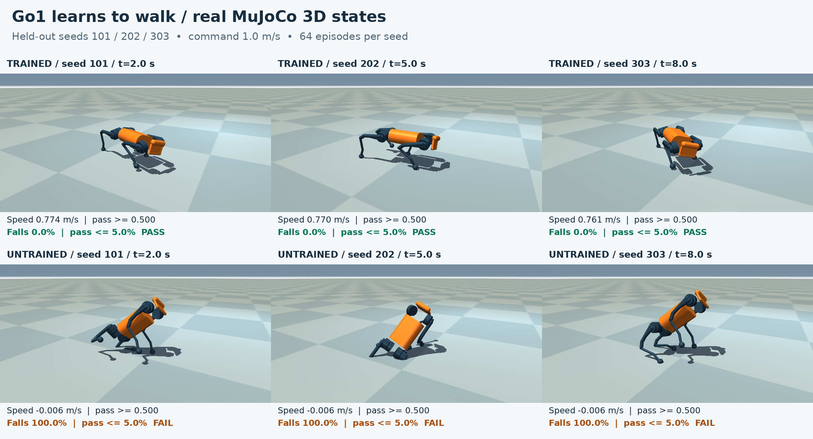

# Train a Go1 to walk on a GPU slice

Train a Unitree Go1 quadruped from random weights with PPO and batched
MuJoCo-Warp on a disposable **4 GiB RTX 5090 slice**. The artifact is a
training config and a small policy checkpoint. An independent judge
then runs the policy itself in single-threaded CPU MuJoCo on held-out
seeds, measuring forward travel, falls and actuator torque. It ignores
all claimed results in the artifact. A sandbox provides the pinned GPU
stack without a workstation or a local CUDA installation, ships the
model into a networkless lease, and destroys that lease after the run.

## One-command run

From the repository root, with Python 3.10+ and `SBX_API_KEY` exported:

```bash
python3 cookbook/go1-walk/run.py
```

The runner uses standard-library REST calls, not a GPU template or a
local physics installation. It creates a lease, validates the pinned
image, ships the source and model, trains in resumable chunks, downloads
the checkpoint to `cookbook/go1-walk/out/`, runs the real mutation
self-test, grades the checkpoint, prints the verdict JSON and step wall
times, then always deletes the lease and confirms `GET` returns 404.
Only data files from the artifact reach the judge; no artifact code runs.

For a fresh lease grading the committed checkpoint without retraining:

```bash
python3 cookbook/go1-walk/run.py --skip-train cookbook/go1-walk/examples/good
```

Useful flags: `--config FILE`, `--iters N`, `--chunk-s N`, `--outdir DIR`,
`--trace` (exact judge-scored states), `--seeds 101,202,303`,
`--vram N`, and `--keep` (intentional cleanup opt-out).
`--no-selftest` is for exploration only, not a complete demo run.
`GO1_LEASE_WAIT_S` controls how long to wait for a free GPU seat (300 s
by default). Exec replies are cached under a per-request token on the
lease, so a lost reply can be recovered without repeating training.
The key needs GPU access and capacity. Every API request must bypass an
HTTP proxy that truncates long requests, for example prefix the command
with `env -u HTTPS_PROXY -u https_proxy -u HTTP_PROXY -u http_proxy`.
The platform does not impose the local proxy's 600 s request cap.

Measured training throughput, evaluation numbers, memory observations,
and two fresh complete runs are recorded with raw output in
[RECEIPT.md](RECEIPT.md). Retraining is stochastic; exact checkpoint
reproduction and retraining are different guarantees.

### Measured result

The fresh training run and fresh checkpoint replay both passed:
**0.768245 m/s**, **0/192 falls**, **7.6125%** maximum per-seed
torque saturation, **0.769472 m/s** above the best baseline, and
**11/11 mutants killed**. Evaluation uses seeds 101/202/303.

| Step | Fresh training | Fresh checkpoint replay |
|---|---:|---:|
| Create lease | 3.471 s | 3.865 s |
| Validate pinned stack | 3.134 s | 18.784 s |
| PPO only | 486.1 s | Not retrained |
| Final grade, including transport | 188.902 s | 472.812 s |
| Complete run, including self-test and cleanup | 4012.310 s | 2652.438 s |

PPO simulated 49,152,000 environment steps at 101,114 env-steps/s.
PyTorch's peak reserved memory was 736,100,352 bytes, **not** total GPU
memory. Full acceptance is much slower than training: repeated CPU
grades, checkpoint transfer and API delays dominate these measured runs.
Commands, intermediate failures and complete output are in
[RECEIPT.md](RECEIPT.md).

## See the simulation



[MuJoCo 3D video](media/demo.mp4) · [Training and judge loop](media/loop.png)

```bash
bash cookbook/go1-walk/media/make_media.sh
```

Media needs Linux x86-64, Python 3.12, ffmpeg, DejaVu Sans fonts and EGL
(OSMesa fallback). It installs a SHA256-checked render environment,
grades the checkpoints on a fresh lease, and replays **the exact states
that were graded**, not a newly simulated or interpolated animation.
MuJoCo renders the robot, textured floor, sky and shadows; Pillow adds
labels and draws the training/judge-loop figure. Each video frame
asserts qpos agreement within 1e-9. The 30 s, 1080p, 30 fps web video
comes from an ignored lossless master. Provenance and visual inspection:
[MANIFEST](media/MANIFEST.json), [REVIEW](media/REVIEW.md).
The falling comparison is a genuinely untrained network with broad
random initial weights, not the PPO step-0 mean network (which can stand).
After a successful collection, `make_media.sh --render-only` can rebuild
the visuals from the cached judge states without another lease. It rejects
a changed checkpoint, model, trace hash or measured result.

## Ask your agent

> Read `cookbook/go1-walk/SPEC.md`. Train a Go1 walking policy with the
> shipped PPO trainer and model on a 4 GiB GPU lease. You may edit your
> training config, but never the judge or its model. Use
> `python3 cookbook/go1-walk/run.py --config <your-config.json>` to create
> the networkless lease, ship the job and train. The judge independently
> simulates the checkpoint on seeds 101, 202 and 303, which must never
> enter training. Iterate on the policy until all five gates pass, and
> keep every real verdict in a loop log. Run the mutation self-test.
> Report measured velocity, fall rate, torque saturation, baseline
> margin, training wall time and env-steps/s. Always delete every lease
> you create and confirm GET returns 404. If a gate fails, report it
> rather than claiming the demo works.

## The judge

It grades 64 episodes per seed, 500 control steps at 50 Hz (10 s), with
command `(1.0, 0.0, 0.0)`. A fall freezes an episode; displacement is
still divided by the full 10 s.

| Gate | Numeric acceptance rule |
|---|---|
| G1 forward speed | Mean forward displacement / 10 s ≥ 0.5 m/s |
| G2 falls | Episodes with any fall ≤ 5% |
| G3 torque | Saturated live actuator samples ≤ 15%; peak torque within actuator limits |
| G4 baseline | Beats the better zero/random-action baseline by ≥ 0.30 m/s |
| G5 determinism | Same seed produces identical metrics |

This is a task-specification oracle, not an analytic optimal gait.
The float64 CPU judge is intentionally independent of the float32 Warp
training environment. Two complete grades must give byte-identical
verdict JSON except `timing`; self-test enforces that.

```bash
bash cookbook/go1-walk/judge/setup.sh
bash cookbook/go1-walk/judge/selftest.sh
bash cookbook/go1-walk/judge/grade.sh cookbook/go1-walk/examples/good --json verdict.json
```

`grade.sh` prints one JSON verdict to stdout; lifecycle messages go to
stderr. Mutants include the actual step-0 and 5%-of-budget checkpoints,
an actually trained velocity-reward-sign counterfactual, zero/negated/
shuffled/noisy/saturating/weak outputs, and evaluation on a 2×-mass robot.
Crashes or stack drift never count as mutant kills.

## Limits and provenance

- This is a learning demo, not a hardware-ready robot controller.
- Flat floor, foot-only contacts, crouched home pose, no terrain or
  sim-to-real validation. Fallen bodies can penetrate the floor, so
  evaluation stops them at the first fall.
- Training uses seed 1 and speeds in `[0.4, 1.0]` m/s. The judge's seeds
  are held out; 1.0 m/s is an endpoint of training, not an unseen speed.
- The policy is a `45 → 512 → 256 → 128 → 12` ELU MLP producing clipped
  position offsets for PD actuators. It can fail to learn a gait.
- The requested allocation is 4 GiB. PyTorch memory counters exclude
  Warp and driver allocations; they are not a total-VRAM measurement.
- Model: [MuJoCo Menagerie Go1](model/README.md), pinned commit and
  **BSD 3-Clause** licence in [model/LICENSE](model/LICENSE). Rendering
  uses the shipped primitive 3D geometry, not downloaded meshes.
- Pinned image: Python 3.13, MuJoCo/MuJoCo-Warp 3.8.1, Warp 1.13.0,
  NumPy 1.26.4, PyTorch 2.10.0 with CUDA 12.8. Setup and grade fail on drift.

See [SPEC.md](SPEC.md). Independent reproduction by a different agent is
required before merge; this builder does not write `REPRODUCE.md`.
