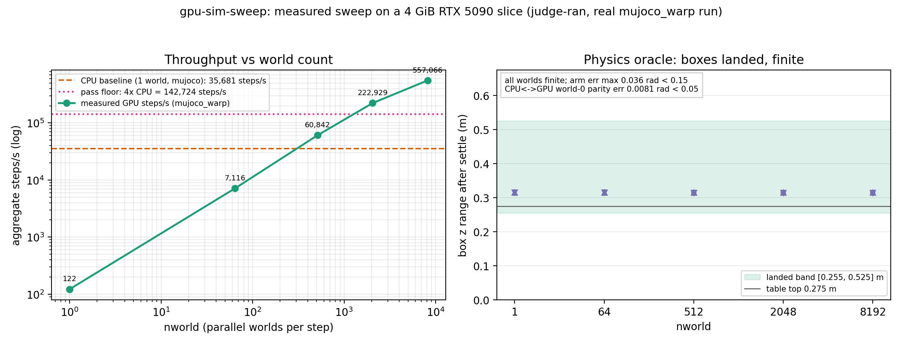
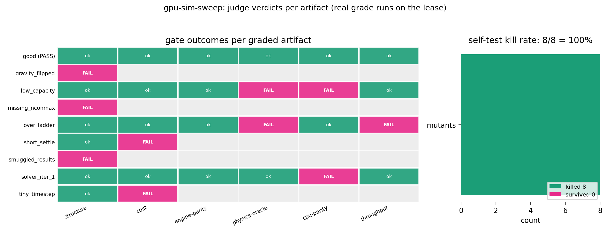

# GPU sim sweep: one world on CPU, thousands on a GPU slice

An agent works on a real GPU-simulation engineering problem inside a disposable
sandbox: configure a MuJoCo-Warp scene (a 7-DoF arm + 8 falling boxes on a
table), sweep it over nworld = 1..8192 on a 4 GiB RTX 5090 slice, and pass a
judge that re-runs the physics itself. The artifact is a **config only** — the
judge never reads a result the artifact claims; it runs the CPU baseline and
the whole mujoco_warp sweep during grade and gates on what it measures.

A sandbox helps because GPU simulation work is messy: it pins a specific
mujoco/mujoco-warp toolchain without touching your machine, safely runs
untrusted agent-written configs, and gets destroyed afterwards. On a CPU-only
sandbox the judge runs `--cpu-check` (structure + a live CPU physics oracle);
on a GPU sandbox it runs the full path — CPU baseline, the real sweep at every
ladder point, CPU↔GPU trajectory parity, and the throughput gate. The GPU path
uses a 4 GiB VRAM slice lease over the REST API (see
`cookbook/small-gpu/run.py`) with `run.py --gpu`.

## One-command run

From this repository's root, with Python 3.10+ and the `sbx` CLI
(`pip install "git+https://github.com/agent-next/sandbox#subdirectory=cli"`)
and `SBX_API_KEY` exported:

```bash
python3 cookbook/gpu-sim-sweep/run.py            # CPU sandbox: --cpu-check judge
python3 cookbook/gpu-sim-sweep/run.py --gpu      # GPU lease: full judge + mutants
python3 cookbook/gpu-sim-sweep/run.py --ref sbx/demo-gpu-sim-sweep   # other ref
```

Each run prints wall time per step, the verdict JSON, and a short human
summary, then kills the sandbox/lease and confirms it is gone. `--gpu` packs
the local checkout's `judge/` + `examples/` onto the lease (the `--ref` flag
applies to the CPU-sandbox clone path only). The GPU path takes minutes, not
seconds — measured ~6.5–9 min end-to-end (slower when the shared GPU node is busy): a
fresh lease cold-compiles the Warp kernels once (~86–120 s, reported as setup
time) and each grade — the good
config and every mutant — runs real simulations (good ~145–211 s; mutants
≤ ~1 s when the structure/cost gates reject them, up to ~125 s for the three
sim-running mutants). These ranges cover the two builder runs in
[RECEIPT.md](RECEIPT.md#key-numbers-side-by-side) (86.3/96.5 s cold compile,
145/163 s good grade) and the [acceptance log](media/data/gpu-run.log)
(104.945 s cold compile, 169 s good grade), and the busy-node independent
run in [REPRODUCE.md](REPRODUCE.md) (119.5 s cold compile, 211 s good grade,
538 s total).

To try the judge locally instead, use x86-64 Linux with CPython 3.12 as
`python3` (the setup lock contains only cp312 wheel hashes; the GPU lease
uses its separate preinstalled toolchain):

```bash
bash cookbook/gpu-sim-sweep/judge/setup.sh      # pinned venv in ~/.venvs/gpu-sim-sweep
bash cookbook/gpu-sim-sweep/judge/selftest.sh   # good passes, mutants die (real runs)
bash cookbook/gpu-sim-sweep/judge/grade.sh cookbook/gpu-sim-sweep/examples/good/sweep.json
```

Limits, stated plainly: physics correctness is the gate; throughput is gated
against a floor (default 4× measured CPU, `--speedup-floor F` to change).
The CPU judge proves the config simulates sanely on one world; it cannot
measure GPU throughput or contact-capacity failures — those need the lease.
See `SPEC.md` for the exact gates, `RECEIPT.md` for real measured output.

## GPU path details

The `--gpu` flag creates a 4 GiB VRAM slice lease via the agent-next REST API:
- `POST /sandboxes {"accel":{"vram_gb":4,"reserve":"exec"}}` — creates the lease
- `POST /sandboxes/{id}/exec {"code": <python>, "timeout_s": N}` — one exec
  unpacks `judge/` + `examples/`, then one exec per grade (good + every
  mutant); each grade runs the sim itself. Every exec timeout is well under
  600 s (the platform drops replies at 600 s): the judge's cost gate bounds
  each grade's work before it simulates, so no grade comes close.
- `DELETE /sandboxes/{id}` + `GET /sandboxes/{id}` → 404/dead — confirms cleanup

The lease image already has Python 3.13, mujoco 3.8.1, mujoco-warp 3.8.1,
warp-lang 1.13.0, numpy 1.26.4 on an RTX 5090 slice (cc 12.0); no pip needed.

## Ask your agent

With the sandbox plugin installed, paste this prompt. The agent designs
and fixes the sim config itself in a sandbox and iterates with the judge until
it passes — that loop is the demo:

> Create a fresh sandbox (GPU lease, `vram_gb: 4` if GPU access is on
> my key; otherwise a plain sandbox and the judge's `--cpu-check` mode).
> Inside it, clone https://github.com/agent-next/sandbox at ref `main`,
> then read `cookbook/gpu-sim-sweep/SPEC.md` carefully: you are to write a
> sim config, `sweep.json`, with exactly the keys in the spec's artifact
> contract — the canonical scene XML (from `judge/scene.py`), timestep,
> solver_iterations, nconmax/njmax contact capacity, the nworld ladder, and
> the settle/timed/batch counts. The artifact is config only: the judge
> runs the simulation itself and rejects result keys, so do not add any.
> First run `cookbook/gpu-sim-sweep/judge/setup.sh`, then write your
> config, then iterate: `bash cookbook/gpu-sim-sweep/judge/grade.sh
> /path/to/your/sweep.json --json /tmp/v.json` and read the verdict JSON
> until every gate passes. The judge's self-test shows what it rejects —
> run `judge/selftest.sh` once to see the broken mutants die in real runs.
> When every gate passes, report the verdict JSON (measured CPU steps/s,
> top GPU steps/s, speedup, and per-point oracle results), then kill the
> sandbox and confirm it is gone. If you cannot get a gate to pass, say
> exactly which gate and what you tried, and stop.

## What the judge checks (short form)

| gate | rule |
|---|---|
| structure | valid JSON, config keys only (result keys rejected), scene = canonical |
| cost | the work the config asks for is bounded (simulated-time windows, step counts, aggregate world-steps) — checked before any sim runs |
| engine-parity | measured GPU mujoco version == measured CPU version |
| physics-oracle | every nworld ran; live state: finite, arm err < 0.15 rad, boxes landed, speed < 5 m/s |
| cpu-parity | measured GPU world-0 trajectory vs CPU within 0.05 rad |
| throughput | measured top nworld steps/s ≥ floor × measured CPU steps/s (default 4×) |
| cpu-physics | (cpu-check mode only) the CPU reference run of the config passes the same oracle |

The artifact is graded from a copy in a temp dir, and sha256 checksums of
`judge/` are compared before and after — the artifact cannot tamper with
its own judge. A judge crash exits 2; a graded failure exits 1.

## Results





**[Watch the 3D replay](media/demo.mp4)**, 26 s, 1920×1080 at 30 fps:
the arm reaches its joint target and eight boxes fall and settle, rendered
by MuJoCo's own offscreen renderer with textures, lights and shadows.
The 4×4 scale view repeats the reference world honestly: the judge initializes
every GPU world identically. Its count-up reveals measured endpoints, not
a live performance meter.

The 2026-10-15 acceptance run (`python3 run.py --ref sbx/sweep-r4 --gpu`,
seed 0, 383 s) measured **686,725 steps/s at nworld 8192 vs 26,574 CPU,
25.8×** (floor 4×), parity error **0.00811 rad**, and **8/8 mutants killed**
on a 4 GiB RTX 5090 slice. The ladder was 134 / 10,785 / 77,008 / 248,064 /
686,725 steps/s; cold Warp compile was 104.945 s.

Frames are labelled **“MuJoCo CPU reference replay of world 0”**, not GPU
renders. The exact config, timestep, initial state and controls are replayed
through the judge's `cpu_reference`; its measured CPU oracle must match
within 1e-9. Every rendered pose must match the CPU data within 1e-9.
Retained GPU samples are checked at the judge's 0.05 parity tolerance,
not claimed equal to CPU floating-point states. `loop.png` is an explicitly
labelled config-fixing replay of two real mutant verdicts and the good
verdict, not an invented live agent history.

Regenerate without a lease (Python 3.11+, ffmpeg/ffprobe, DejaVu fonts,
EGL-capable GPU or OSMesa software fallback):

```bash
bash cookbook/gpu-sim-sweep/media/make_media.sh
```

The script installs the pinned MuJoCo/Pillow media dependencies, replays and
checks the physics, renders every frame, writes a git-ignored lossless master,
encodes H.264, and runs the media tests. Source measurements:
[`media/data/report.json`](media/data/report.json). Provenance and visual
inspection: [MANIFEST.json](media/MANIFEST.json), [STORYBOARD.md](media/STORYBOARD.md),
[REVIEW.md](media/REVIEW.md). The acceptance run is separate from the two
builder runs in [RECEIPT.md](RECEIPT.md).
