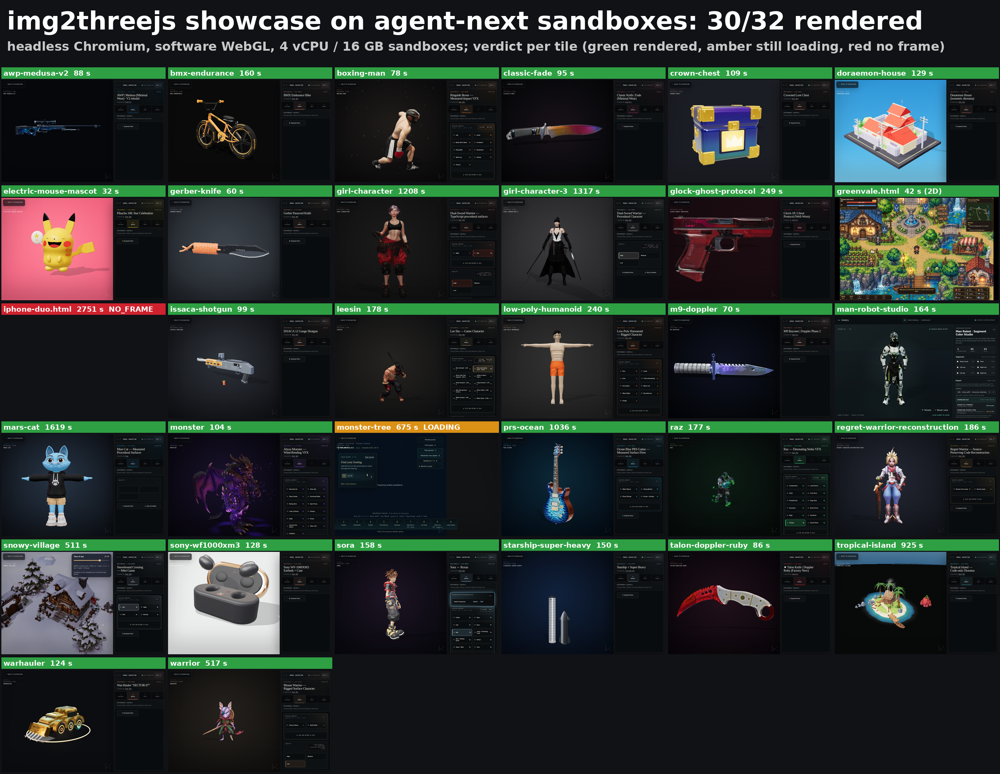

# img2threejs-showcase

Build the [img2threejs showcase](https://github.com/img2threejs/img2threejs-showcase) gallery
(procedural Three.js models rebuilt from one reference image each) in disposable agent-next
sandboxes, render every demo headless, and grade each one. The gallery is fetched at a pinned
commit inside the sandbox.



The demo video (`media/make_media.sh` writes it, cut to `media/STORYBOARD.md`) is not committed:
it has not passed the blind review panel yet (`media/REVIEW.json`).

Why a sandbox helps: the production build needs more memory than a laptop shell usually has free
(it OOMs at 3 GB), and rendering 32 WebGL scenes in software takes hours on one machine. Here
each shard gets its own 4 vCPU / 16 GB sandbox and the shards run in parallel.

Ask your agent:

> Build the img2threejs showcase in sandboxes, render every demo headless, and tell me which ones
> render.

Run (writes screenshots, clips and `results.json` to `./img2threejs-showcase-<timestamp>/`):

```bash
pip install "git+https://github.com/agent-next/sandbox#subdirectory=cli"
export SBX_API_KEY=<your key>
python3 cookbook/img2threejs-showcase/run.py                 # all demos, 8 shards
python3 cookbook/img2threejs-showcase/run.py --only crown-chest bmx-endurance --shards 1
python3 cookbook/img2threejs-showcase/run.py --only monster-tree --patience 3   # 3x every wait
```

What it does per shard: register (once) a 4 vCPU / 16 GB template from `node:22-bookworm`,
create a sandbox, clone the showcase at `5b3078e`, `npm ci`, `npm run build`, serve `dist/` with
`vite preview`, install Chromium (Playwright 1.48.2), render each target for up to 30 minutes
(times `--patience`),
encode one H.264 clip per target, download screenshots, clips and `results.json`, kill the sandbox.
A sandbox whose download fails is kept and its id printed.

Offline check of the shard bookkeeping: `python3 -m unittest test_run` in this directory.

## Grading

`render_all.cjs` grades each target from the composited screenshot of its largest canvas:

- `PASS`: luma standard deviation > 3 and > 20 distinct 12-bit colours, and the viewer's
  "Framing" loading overlay has cleared (waits up to 300 s).
- `LOADING_OVERLAY`: drawn, but the overlay never cleared.
- `FAIL`: no canvas, a flat frame, or no frame within the 600 s screenshot timeout.

Every shard first renders two controls through the same path: `controls/ctl-pos.html` (a WebGL
triangle fan) must `PASS` and `controls/ctl-neg.html` (a cleared, empty WebGL canvas) must `FAIL`.
They did on every shard (luma std 91.2 vs 0).

Known oracle limits, found by looking at the frames: HTML panels drawn over the canvas add
variance, so a scene that is still loading can pass the pixel check (`monster-tree`); and the
overlay text check misfired once on a fully drawn model (`girl-character-3`). Look at the
screenshots before trusting a verdict.

## Results (measured 2026-10-14, CPU-only sandboxes, software WebGL)

32 targets: the 30 demos registered in `src/demos/registry.ts` plus the `greenvale.html` and
`iphone-duo.html` pages (`src/demos/coffee-house` exists but is not registered, so it has no
route). Verdicts were checked by eye and by a second vision model.

| outcome | count | targets |
| --- | --- | --- |
| fully rendered | 30 | all others (29 Three.js models and `greenvale.html`, a 2D PixiJS page) |
| still loading at capture | 1 | `monster-tree` (still "Preparing nearby woodland" after 675 s at `--patience 3`) |
| no frame | 1 | `iphone-duo.html` (no screenshot within 30 min at `--patience 3`) |

Wall times: `npm run build` 3 min 25 s alone, 11-13 min with 8 shards building at once on a shared
host; per target 32 s (`electric-mouse-mascot`) to 27 min (`mars-cat`), median about 2.5 min.
Heavy open-world scenes (`tropical-island`, `snowy-village`, `prs-ocean`, `mars-cat`) need 8-27
minutes per frame on software WebGL; a GPU would remove most of that.

Full per-target table and run log: `RECEIPT.md`.

## Media

`media/result.png` (every target's final screenshot with its verdict), `media/demo.mp4` (not
committed until it passes the review panel; 1920x1080,
H.264 crf 18, 54 s; slots and sources in `media/STORYBOARD.md`: one rendered scene, the command
beside the result grid, the first 450 s of one target's recording at 50x speed, the last 2.5 s of 9
more targets' recordings, every screenshot on three pages, the verdicts with the controls, and the
launch prompt; the blurred backdrop and the 25% push-in are added in post; it passes
`cookbook/tools/video_gate.py`), `media/REVIEW.json` (two blind judges, see Review panel in
`cookbook/DEMO-STANDARD.md`), `media/MANIFEST.json` (sources and sha256). Regenerate from run
outputs, oldest first:

```bash
cookbook/img2threejs-showcase/media/make_media.sh RUN_DIR [RUN_DIR ...]   # needs Pillow + ffmpeg
```

`media/visual.json` holds the by-eye verdicts that override the automatic gate (checked by a
second vision model); `media/notes.json` marks targets that are not Three.js.

## Limits

- No GPU: Chromium renders with SwiftShader, so frame times are minutes, not milliseconds.
- The default 2 vCPU / 3 GB sandbox cannot build this repo (`vite build` and esbuild are
  OOM-killed); the run registers a `standard` template for that reason.
- The showcase repository has no licence file; its rendered output is shown here as test evidence.
