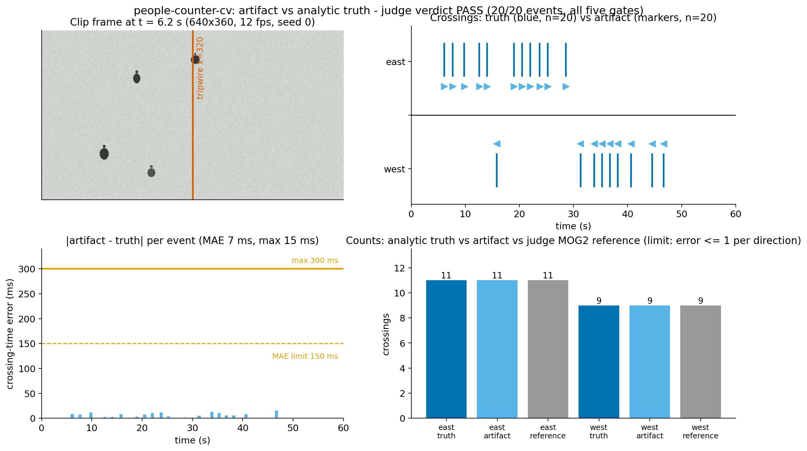

# People counter CV: one camera, one tripwire, an analytic judge

An agent works on a real computer-vision engineering problem inside a
disposable sandbox: given only a neutral sensor spec — a 640×360 grayscale
overhead clip of a walkway with a tripwire at mid-frame — write a
classical-CV people counter as one Python file, and iterate against a
judge it cannot fool. The judge never accepts "the detector ran": the
clip is scripted, so every true crossing is known **analytically** from
the piecewise-linear trajectories, and the counter's CSV must land on
those times and counts within stated tolerances — per-direction count
error ≤ 1, recall and precision ≥ 0.98, crossing-time MAE ≤ 0.15 s,
direction accuracy 100 % — plus agree with the judge's own
independently implemented MOG2 reference counter. The scene has teeth:
decoys that turn back at the line, people that walk in and stand there,
a genuine double-crosser, a global illumination drift, sensor noise, and
two trolleys wider than any pedestrian that must not be counted.

A sandbox helps because agent-written vision code is exactly the kind of
thing you should not run on your own machine: the judge generates the
clip, executes the artifact from a copy, checksums itself before and
after, and scores the result without touching anything local. The whole
judge — pinned opencv-python-headless 4.13.0.92 wheel set, self-test with
9 mutants, grading — runs from nothing in a fresh sandbox in about six
minutes.

## One-command run

From this repository's root, with Python 3.10+ and the `sbx` CLI
(`pip install "git+https://github.com/agent-next/sandbox#subdirectory=cli"`)
and `SBX_API_KEY` exported:

```bash
python3 cookbook/people-counter-cv/run.py --ref main
python3 cookbook/people-counter-cv/run.py --ref sbx/demo-people-counter-cv-f4
```

Each run prints wall time per step (clone, setup, selftest, grade), the
verdict JSON, and a short human summary, then kills the sandbox and
confirms it is gone. Measured in fresh sandboxes (see RECEIPT.md): total
5.5–7 min end-to-end (selftest dominates: 12 grades of good + 9 mutants
+ determinism pair, ~15–40 s each).



[Watch the counter work and the PASS table](media/demo.mp4) · [Agent
loop](media/loop.png). Regenerate with
`bash cookbook/people-counter-cv/media/make_media.sh` (Python 3.10–3.13,
ffmpeg; installs pinned local toolchains).

To try the judge locally on a CPU-only Linux box instead (run all three
from this repository's root — grade.sh resolves the artifact path
relative to your working directory):

```bash
bash cookbook/people-counter-cv/judge/setup.sh      # pinned venv in ~/.venvs/people-counter-cv
bash cookbook/people-counter-cv/judge/selftest.sh   # known-good passes, 9/9 mutants killed
bash cookbook/people-counter-cv/judge/grade.sh cookbook/people-counter-cv/examples/good/counter.py
```

## The sensor spec and its oracle

The agent sees `judge/spec.json` and nothing else — sensor, population,
output contract, and **no expected counts**. The judge derives the
answers from the scripted scene itself:

| check | oracle |
|---|---|
| counts | analytic truth: 20 crossings for seed 0 (11 east, 9 west); trolleys excluded |
| times | piecewise-linear trajectories → closed-form crossing times; MAE ≤ 0.15 s, max ≤ 0.30 s |
| directions | east = +x through the tripwire; 100 % accuracy required |
| cross-method | the judge's MOG2 reference counter on the same clip must agree (≤ 1 count/direction, ≤ 0.35 s/event) |

## Ask your agent

With the sandbox plugin installed, paste this prompt. The agent writes
the counter itself in a sandbox and iterates with the judge until it
passes — that loop is the demo:

> Create a fresh sandbox. Inside it, clone
> https://github.com/agent-next/sandbox at ref `main`, then read
> `cookbook/people-counter-cv/SPEC.md` carefully: you are to write a
> classical-CV people counter as one file, `counter.py`, that reads
> `cookbook/people-counter-cv/judge/spec.json` from its working
> directory, watches the clip the judge generates at `input/video.avi`,
> and writes `crossings.csv` exactly as the spec's artifact contract
> says. The spec contains no expected counts — detect honestly; truth
> times hard-coded in your file are rejected by gate 1. First run
> `cookbook/people-counter-cv/judge/setup.sh` to install the pinned
> toolchain, then iterate:
> `bash cookbook/people-counter-cv/judge/grade.sh /path/to/your/counter.py --json /tmp/v.json`
> and read the verdict JSON until every gate passes (structure, run,
> csv-shape, oracle, and agreement with the judge's own reference
> counter, which you never see). Watch for decoys that turn back at the
> line, people that stop next to it, and trolleys wider than the
> pedestrian range — the truth says none of those are crossings. The
> judge's self-test shows what it rejects — run `judge/selftest.sh` once
> to see 9 broken mutants die. When every gate passes, report the verdict
> JSON (counts, recall, precision, time MAE, worst agreement deviation),
> then kill the sandbox and confirm it is gone. If you cannot get a gate
> to pass, say exactly which gate and what you tried, and stop.

## What the judge checks (short form)

| gate | rule |
|---|---|
| structure | ≤ 96 KiB, byte-compiles, uses `cv2.VideoCapture`, reads the spec at runtime, < 3 float literals within 2 % of a truth time |
| run | exits 0 within 300 s, writes `crossings.csv` |
| csv-shape | header `t_cross_s,east,west`, one-hot 0/1, sorted, finite times inside the clip |
| oracle | count error ≤ 1 per direction, recall/precision ≥ 0.98, time MAE ≤ 0.15 s, max ≤ 0.30 s, direction accuracy 100 % |
| agreement | vs the judge's MOG2 reference counter: count diff ≤ 1 per direction, paired events ≤ 0.35 s apart, ≤ 1 unpaired per side |

The artifact is graded from a copy in a temp dir, and sha256 checksums of
`judge/` are compared before and after — the artifact cannot tamper with
its own judge. `judge/selftest.sh` grades the 9 scripted mutants
(shifted line, width filter off, direction flip, high threshold,
presence counting, missing clip, hard-coded truth, wrong fps, unsorted
rows) and a determinism check (two grades → byte-identical verdicts
except `timing`); kill rate 9/9 = 100 %.

## Limits, stated plainly

- The oracle is only as strong as the scene script: it certifies counting
  behaviour on this clip family (seeded variants of the same walkway),
  not on arbitrary surveillance video. Counts on unseen footage are a
  claim this demo does not make.
- The judge pins OpenCV + NumPy and runs CPython 3.10–3.13 on x86-64
  Linux; a counter needing other wheels fails gate 2.
- The illumination drift (±12 over 20 s) is global and slow by
  construction; a counter only needs mean-normalisation or an adaptive
  background to beat it, not exposure control.
- The good counter's margin is real but not infinite: time errors are
  ~0.015 s against a 0.30 s max tolerance on the seeds tried (0 and 1);
  a different seed is the same scene family with different concrete
  trajectories.
