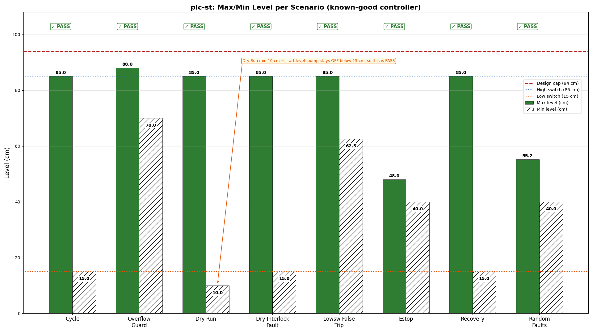
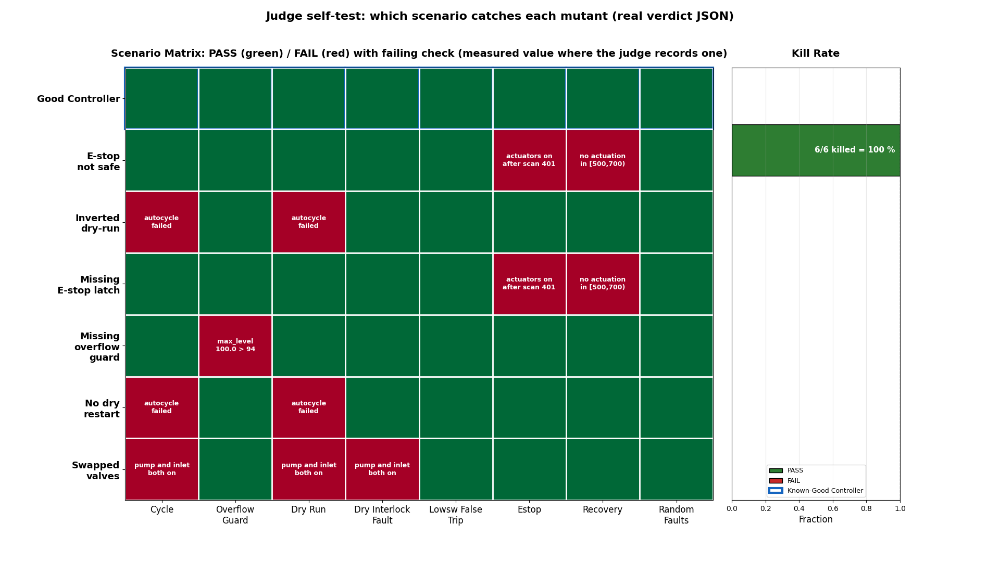

# plc-st: an IEC 61131-3 tank controller with a virtual plant

An agent writes a tank fill/drain controller in IEC 61131-3 **Structured Text**,
compiles it with the open [MATIEC](https://github.com/thiagoralves/matiec)
`iec2c` compiler, links it into a real scan-cycle harness (10 ms scans), and
runs it against an analytic virtual plant — pumps, valves, level switches and
a level transmitter. A judge it cannot fool then checks the controller with
numeric rules: the level must never leave its safe band, the pump must never
run when the tank is dry (even if a level switch lies), an emergency stop must
de-energize every actuator within one scan and latch until a fresh start, and
the plant must recover to normal cycling afterwards. The known-good example is
checked against six single-edit mutants, so a judge that passes a broken
controller fails its own self-test.

Why a sandbox: the agent must install a pinned compiler, compile its own
Structured Text, and iterate against the judge in an isolated, disposable
machine. Nothing the agent does touches the real plant (there is no real
plant) or your machine. Every run is reproducible end to end.

## Results

| | |
|---|---|
| **Verdict** | ✅ **PASS** — all 8 scenarios passed, 6/6 mutants killed (100% kill rate) |
| **Max level** | 88.02 cm (design cap: 94 cm) |
| **Min level** | 10.00 cm (pump never runs below 15 cm dry band) |
| **Determinism** | Verified — same `--seed` produces identical verdict JSON |


*Figure 1: Max/Min level per scenario for the known-good controller. All 8 scenarios pass; design cap (94 cm), high switch (85 cm), and dry band (15 cm) shown as reference lines. The dry_run min level (10 cm) is the start level — the pump never runs below 15 cm (rule: pump OFF when level < 15 cm).*


*Figure 2: Judge self-test — which scenario catches each mutant. Rows: the known-good controller plus the six single-edit mutants; columns: the 8 scenarios. Green = PASS, red = FAIL with the failing check, plus the measured value vs limit where the judge records one (e.g. max_level 100.0 > 94), all taken from the real verdict JSONs. Kill rate: 6/6 = 100%.*

[▶ demo.mp4 (38s, 1920×1080, H.264, 0.9 MB)](media/demo.mp4)
*Video: Title → Result bar chart → Scenario matrix revealed row by row (good controller, then one mutant per ~0.6 s) → Scenario traces (real per-scan CSV data) → Mutant kills → Final verdict.*

**Key numbers from verdict JSON:**
- Scenarios passed: 8/8
- Kill rate: 100% (6/6 single-edit mutants)
- Max level (all scenarios): 88.02 cm ≤ 94 cm design cap
- Min level (all scenarios): 10.00 cm (pump never below 15 cm dry band)
- Determinism: VERIFIED (same `--seed` → identical verdict)

## What the artifact must do

See [SPEC.md](SPEC.md). The deliverable is a single `tank_ctrl.st` with a
PROGRAM `tank_ctrl` and a CONFIGURATION `tank_cfg`, compiled with the pinned
MATIEC, linked by the supplied harness, and verified by 8 judged scenarios.

## One-command run

```bash
export SBX_API_KEY=<your key>     # https://sbx.agent-next.com/console
python3 cookbook/plc-st/run.py    # needs the sbx CLI (pip install "git+https://github.com/agent-next/sandbox#subdirectory=cli")
```

`run.py` creates a disposable sandbox, clones this repo at `--ref main`
(default; `--ref` to override), runs `judge/setup.sh` → `judge/selftest.sh` →
`judge/grade.sh examples/good/tank_ctrl.st`, prints the verdict JSON, and
always kills the sandbox (`--keep` leaves it up). Non-zero exit on any failure.

Without a key, run the same steps in any Debian 12 box, from `cookbook/plc-st/`:

```bash
bash judge/setup.sh                                   # installs the pinned MATIEC iec2c (uses sudo apt for bison/flex/autotools if missing)
bash judge/selftest.sh                                # good controller + 6 mutants + determinism
bash judge/grade.sh examples/good/tank_ctrl.st --json verdict.json   # default seed 20261014, the seed behind every number on this page
```

Measured wall times (2 vCPU, ~4 GB, Debian bookworm):

| step | wall |
| --- | --- |
| `judge/setup.sh` (fresh install of pinned MATIEC) | ~39 s |
| `judge/selftest.sh` (good + 6 mutants) | ~33 s |
| `judge/grade.sh examples/good/tank_ctrl.st` | ~5 s |
| `sbx create` | ~1 s |

## Rebuilding the media

All media (result.png, loop.png, demo.mp4) is generated from judge output data
that `media/make_data.sh` produces into `media/data/` — verdict JSONs for the
good controller and each mutant, the selftest log, and per-scan trace CSVs —
all committed to git as small text files (sha256s in `media/MANIFEST.json`):

```bash
bash judge/setup.sh            # once: installs the pinned MATIEC iec2c
bash media/make_data.sh        # regenerates media/data/ (fails if not deterministic)
bash media/make_media.sh       # rebuilds result.png, loop.png, demo.mp4
```

Run these from `cookbook/plc-st/`. `make_media.sh` needs `ffmpeg`/`ffprobe` and
network access for its pinned pip packages (matplotlib, numpy, pillow), and takes
about 5 min on 2 vCPU; its `media/.venv` and `media/master/` build outputs are
git-ignored. The committed `media/data/` is enough for `make_media.sh` alone;
`make_data.sh` is only needed to refresh it.

`make_data.sh` grades the good example twice with the same seed and fails if
the two verdict JSONs are not byte-identical, so the determinism claim in the
video is checked on every media rebuild.

## Ask your agent

Paste this into a session with the sandbox plugin enabled:

> In a sandbox, build the IEC 61131-3 Structured Text tank controller for
> `cookbook/plc-st` from scratch. Read `SPEC.md` first, then write your own
> `tank_ctrl.st` (program + configuration) using the pinned MATIEC toolchain
> from `judge/setup.sh`. Iterate with `bash judge/selftest.sh` and
> `bash judge/grade.sh your_tank_ctrl.st --json /tmp/v.json` until the judge
> passes every gate and your controller is not one of the six known-bad
> single-edit mutants. Show me the final verdict JSON and the key numbers
> (max/min level, kill rate). Do not modify anything under `judge/`.

The agent works on the artifact inside the disposable sandbox; the judge lives
in the repo and is never modified by what the agent runs.

## Limits (stated plainly)

- This is an educational interlock exercise, not a certified safety system:
  no SIL rating, no redundant dual-channel architecture, no formal proof.
- Control is bang-bang around two level switches; the analog level is used
  only for independent interlocks and discrepancy detection, not PID.
- The plant model is analytic and deterministic (per-scan integration). It
  has no sensor noise, no valve/pump failure dynamics, no plumbing dynamics;
  the "faults" are scripted stuck/false switch states and E-stop pulses.
- The MATIEC compiler and its IEC runtime are GPL-3.0 / LGPL; the artifact and
  judge code are MIT (this repo). Pinned MATIEC commit
  `75d6e82cce5bc8b98ce03a417b106884cbb7ebb5`, tarball sha256
  `a679c8e69459c2e4a05850438e073866eeb695b598ff244029dac0ea5d8e9a08`. See
  `judge/setup.sh` and `judge/VERSIONS.txt`.