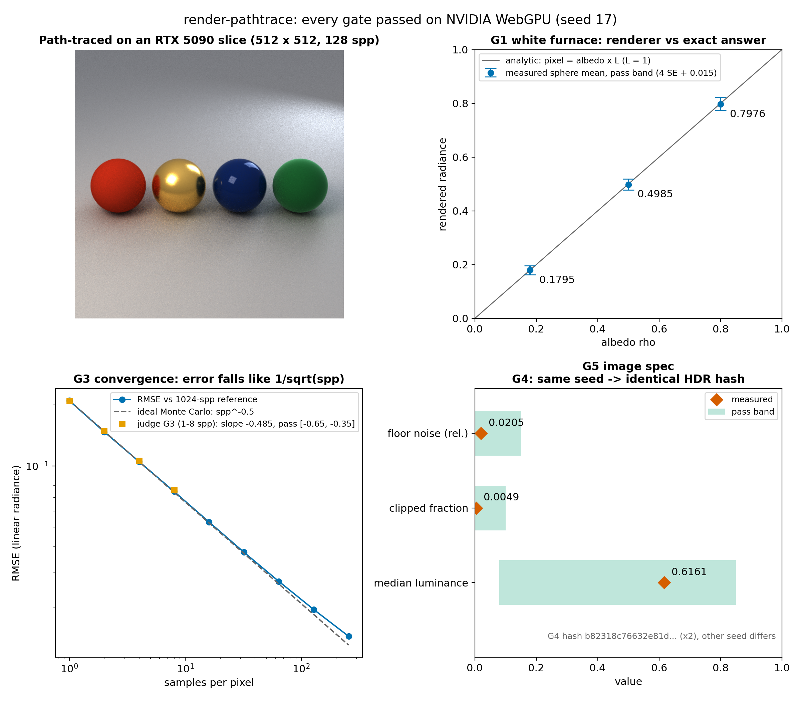

# Material studio with a physical judge

An agent designs OpenPBR spheres on a studio floor. A trusted browser
harness path-traces the scene with [MuTracer 0.1.1](https://github.com/pissang/mutracer)
(MIT). Five numeric gates check an analytic furnace, reflected energy,
Monte Carlo convergence, deterministic HDR hashes and image quality.
A disposable GPU `browser` sandbox supplies real NVIDIA WebGPU. Geometry,
lighting and the environment are procedural; rendering uses no network assets.



Two fresh GPU leases passed every gate with byte-identical HDR output. The whole
run took 100 s and 124 s end to end: about 38 s uploading, 30 s self-test, 6 s
grade, the rest lease creation and cleanup (`RECEIPT.md`). The self-test rejects
8/8 bad scenes plus a halved-albedo renderer control. `media/demo.mp4` shows
real renders converging from 1 to 256 samples per pixel.
The CPU/SwiftShader alternative is a known limitation, not a passing backend.

## Ask your agent

> Use an agent-next GPU `browser` sandbox through the public REST API.
> Work in cookbook/render-pathtrace and read SPEC.md. The sandbox is offline:
> fetch the pinned MuTracer package on the caller, verify its integrity, and
> upload it with the trusted judge (the image already has NumPy 2.2.6). The included run.py does
> this automatically. Use the image's full Chromium and the NVIDIA launch flags
> in judge/driver.py; reject software or unidentified adapters.
> Design scene.json, not JavaScript: three to five distinct OpenPBR spheres,
> a floor, camera, procedural environment and rect/sphere lights.
> Do not edit judge/. Run the physical grade with --backend gpu --seed 17,
> inspect numeric failures, and iterate until every gate passes.
> Keep the scene, verdict, linear HDR buffer, summary and PNG render.
> Report the adapter, furnace means, convergence slope, image metrics and wall
> times. DELETE the lease afterward and confirm GET returns 404.
> No imported models, textures, external render requests or media production.

## One command

From this checkout, with Python 3.10+ and a key with GPU access:

```sh
export SBX_API_KEY='<your key>'
cd cookbook/render-pathtrace
python3 run.py
```

The GPU path snapshots the
**local** trusted judge and scene, not a remote ref. It needs only the Python
standard library on the workstation, not `sbx`, Playwright, NumPy or a GPU.

The runner verifies pinned dependencies on the caller, creates a 2 GiB
`browser` lease, uploads packages and source, runs offline setup, unit tests,
the judge self-test and the final grade, then downloads outputs. It prints the
verdict and per-step wall times. Every exit path deletes the lease in `finally`;
only GET 404 confirms cleanup. Unconfirmed cleanup exits nonzero and names
the lease.

Outputs default to ignored `outputs-<timestamp>/`; use `--output <new-directory>`
to choose another location. `studio.npy` is linear RGBA float32, top row first.
`studio.json` includes its raw HDR hash, shape and RGB statistics. `studio.png`
is a lossless RGB preview using unit-exposure linear clipping, not an artistic
highlight shoulder. `runner.json` records the lease, upload method, step results,
total caller wall time and cleanup HTTP statuses. Logs, verdicts, package
versions and self-test results are also downloaded.

Downloads are cached on the caller under `~/.cache/render-pathtrace` and
integrity-checked again on every run. Files are transferred in small chunks.
The runner prefers the files PUT route; deployments returning HTTP 405 use
idempotent base64 chunk writes through Python exec instead. Neither path
requires network access inside the GPU sandbox. A lost final exec response
is monitored through its output file, never replayed.

`--seed` defaults to 17. `--skip-selftest` is a development shortcut, **not**
an acceptance run. GPU leases cannot be kept with `--keep`.

## Judge and limits

The image provides CPython 3.12, Playwright 1.55.0 and full Chromium
140.0.7339.16 and NumPy 2.2.6. Offline setup verifies these prerequisites and
installs the hash-pinned MuTracer package. On an image without NumPy 2.2.6 the
runner uploads the SHA-256-pinned wheel instead. It performs no pip, npm or
browser network downloads. Package licences remain in the installation.

Inside the prepared GPU job directory:

```sh
sh judge/selftest.sh --backend gpu --seed 17
sh judge/grade.sh examples/good/scene.json --backend gpu --seed 17 \
  --json verdict.json --hdr-out studio.npy
```

The harness serves only loopback HTTP and blocks external browser requests.
The verdict records NVIDIA vendor and architecture, browser and rendering API.
Adapter detection alone does not pass any physical gate. See `SPEC.md` for
all thresholds and sample budgets.

- A 2 GiB lease is a requested VRAM slice, not a graphics allocation-time cap.
  Vulkan/WebGPU allocations can bypass CUDA allocation hooks. The host watchdog
  kills an over-limit lease; its state and outputs can be lost. Budget for
  Chromium and the renderer together. The demo does not test a VRAM overrun.
- G1 checks diffuse transport against the analytic value, not every OpenPBR
  effect. G2 bounds mean energy, not a directional maximum.
- G3 uses random PCG samples, no denoising or adaptive sampling. The expected
  Monte Carlo slope is -0.5. Seeds select disjoint 65,536-sample blocks.
- G5 independently ray-checks its fixed foreground noise patch. Designs must
  keep that patch on the floor.
- Shared GPU load and upload bandwidth affect wall times. No CPU speedup is
  claimed unless the identical scene and spp return a CPU frame.
- The upload dominates wall time: the public files route measured about
  0.1 MB/s per lease, whatever the chunk size.

## CPU limitation

The optional `python3 run.py --backend cpu --ref sbx/demo-render-pathtrace`
uses the `sbx` CLI and a CPU sandbox. It clones that ref and runs the original
CPU setup, self-test and grade. `--keep` applies only to this diagnostic path.
Its image uses Playwright 1.63.0 and Chromium 153.0.8010.12.

Two fresh CPU WebGPU runs lost the SwiftShader device before any HDR frame:
`A valid external Instance reference no longer exists`. They are not accepted
renders. An explicit `--api webgl` judge option diagnoses the WebGL2 fallback;
results from different APIs are not interchangeable. See `RECEIPT.md` for the
bounded CPU fallback attempt and GPU-only timings.

## Source and licence

MuTracer: <https://github.com/pissang/mutracer>, npm `@meimu/mutracer` exactly
0.1.1, MIT. Its npm SHA-512 integrity and SHA-256 are checked before extraction;
the NumPy wheel is SHA-256 checked. MuTracer's 2026-10-14 release is an explicit
exception to the demo standard's two-week dependency-age rule.
The scene is hand-authored procedural data. No package tarballs, binary
dependencies or HDR buffers are committed; `media/` holds only the published
figures and video, regenerated by `sh media/make_media.sh`.
