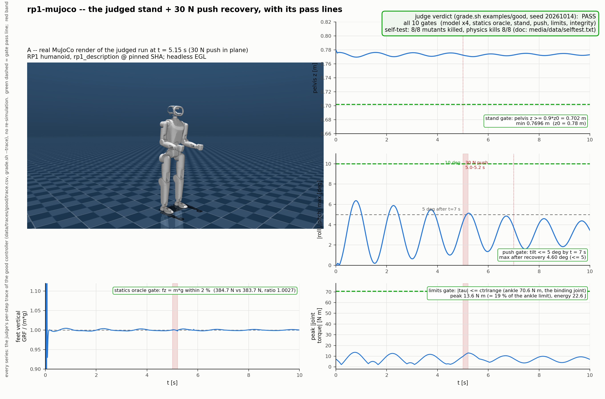
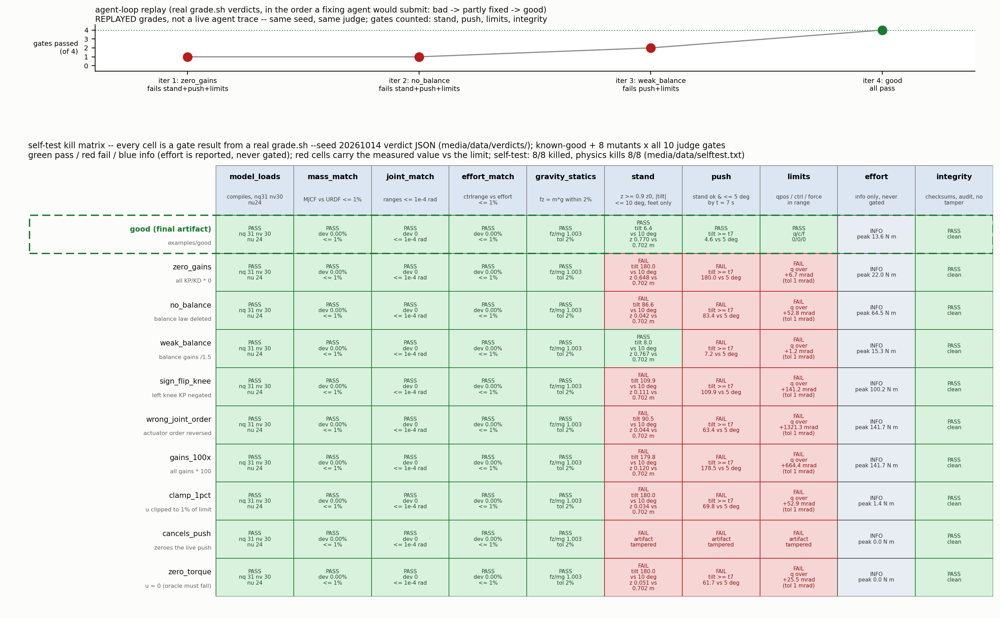

# rp1-mujoco — balance a humanoid a physics judge can grade

An agent has to *write a robot controller*, not just run a simulator:
produce `controller.py`, a PD + balance controller for the open-source
[RoboParty RP1](https://github.com/Roboparty/RP1) humanoid
([model](https://github.com/Roboparty/rp1_description), pinned commit), that
makes the 24-dof, 39 kg robot stand in [MuJoCo](https://mujoco.org) for 10 s
on flat ground and survive a 30 N lateral push at t = 5 s. The judge is
MuJoCo itself plus an independent URDF cross-check (masses, joint ranges,
actuator efforts), a zero-torque statics oracle (foot contact force vs.
`m·g`) and a checksum/audit-hook integrity gate — a controller that falls
over, leans too far, or exceeds joint/torque limits fails, measured from
`mjData`, never from anything the artifact reports. A disposable sandbox is
the right place for this: the agent needs the pinned simulator, the pinned
robot model and a throwaway filesystem to iterate controllers in, and the
graded artifact is one small Python file it hands back.

## Results


*Figure 1: the judged run. Left: a real headless MuJoCo render of the RP1
humanoid at the exact judged state at t = 5.15 s, mid-push, read back from
the judge's own trace (`grade.sh --trace`) — not re-simulated. Right: the
judge's per-step trace of the good controller against each gate's pass line
— pelvis height vs the 0.9·z0 floor (stand gate), torso tilt vs the 10°
limit with the 30 N push marked (stand + push gates), foot contact force vs
`m·g` (the statics oracle) and peak joint torque vs the ankle limit
(limits gate).*


*Figure 2: the judge can fail. Top: the agent loop replayed in the order a
fixing agent would submit — `zero_gains` → `no_balance` → `weak_balance` →
`good` — counting the artifact-dependent gates each real verdict passes.
Bottom: the self-test kill matrix, the known-good plus 8 single-edit
mutants × all 10 gates, every cell a real `grade.sh --json` verdict with the
measured value against its limit. Green = pass, red = fail, blue = info
(reported, never gated). Kill rate 8/8 = 100 %.*

[▶ demo.mp4 (30 s, 1920×1080, H.264)](media/demo.mp4)
*Video: a real MuJoCo turntable of the judged pose, the judged episode in
real time with the live tilt/height readout, then the two figures above,
the zero-torque mutant falling under the stand gate, and the verdict card.
Every 3D frame is a real render of the pinned scene at the state the judge
recorded — nothing is re-simulated and no number is invented.*

Key numbers from the judge verdict (`examples/good/controller.py`,
seed `20261014`):

- **Model**: `nq=31`, `nv=30`, `nu=24`; total mass 39.109 kg, MJCF vs URDF
  worst link deviation 0.0 % (limit ≤ 1 %)
- **Stand**: pelvis minimum 0.7696 m vs floor 0.702 m (≥ 90 % of 0.78 m
  initial); peak torso tilt 6.37 ° (limit ≤ 10 °); no non-foot floor contact
- **Push recovery**: peak tilt in window 5.14 °; tilt after the 2 s recovery
  deadline 4.60 ° (limit ≤ 5 °)
- **Statics oracle**: feet vertical contact force 384.70 N vs `m·g` =
  383.66 N (ratio 1.0027, limit within 2 %)
- **Effort**: mechanical energy 22.6 J, peak torque 13.6 N·m, RMS 14.7 N·m
- **Self-test kill rate**: 8/8 = 100 % (requirement ≥ 90 %)
- **Finding, not failure**: five right-side joints carry mirror-sign ranges
  (`right_hip_roll`, `right_knee`, `right_shoulder_pitch`,
  `right_shoulder_roll`, `right_elbow`) — an upstream quirk consistent
  between the URDF and MJCF; see SPEC.md.

## Ask your agent

> Set up a sandbox and solve the demo in `cookbook/rp1-mujoco/` of
> https://github.com/agent-next/sandbox (clone it first). Run
> `bash cookbook/rp1-mujoco/judge/setup.sh`, read
> `cookbook/rp1-mujoco/SPEC.md`, then write the artifact yourself:
> `controller.py` (stdlib + numpy only) exposing
> `Controller(model, data, params).compute_ctrl(t) -> np.ndarray` of 24
> actuator commands that makes the RP1 stand 10 s, stay within the tilt and
> pelvis-height limits, survive the 30 N push, and respect every joint and
> actuator limit. Iterate with
> `bash cookbook/rp1-mujoco/judge/grade.sh <your-controller.py> --json v.json`
> until it exits 0, then paste the final verdict JSON. Do not edit anything
> under `judge/`; if you believe the judge is wrong, say so instead of
> working around it. Kill the sandbox when you are done.

The known-good example in `examples/good/` is a PD posture tracker with
gravity feedforward and an ankle-strategy balance law (written for this
demo, no third-party code); a working answer does not have to be.

## One-command run

```bash
pip install "git+https://github.com/agent-next/sandbox#subdirectory=cli"
export SBX_API_KEY=<your key>
python3 cookbook/rp1-mujoco/run.py          # --ref main --keep supported
```

Creates a sandbox, clones the repo, installs pinned tools, runs the judge
self-test, grades `examples/good/controller.py`, prints the verdict JSON,
then kills the sandbox and confirms it is gone. Stdlib only; exits non-zero
on any failure, naming the sandbox id if cleanup cannot be confirmed.

## Measured wall time (Debian sandbox, 2 vCPU, ~4 GB RAM)

| step | wall time |
|---|---|
| `git clone --depth 1` | ~1 s |
| `judge/setup.sh` (fresh install: venv + pinned wheels + model clone) | ~75 s (idempotent re-run: ~2 s) |
| `judge/selftest.sh` (good ×2 + 7 mutants + determinism check) | ~4 min |
| `judge/grade.sh examples/good/controller.py` | ~26 s |

Whole run, including sandbox create and kill: a few minutes; a single
grading is under 30 s. `run.py` prints a per-step timing line.

## Limits, plainly

- The upstream robot-model repository
  ([rp1_description](https://github.com/Roboparty/rp1_description)) carries
  **no licence file**. This demo therefore never vendors its files:
  `judge/setup.sh` clones it at the pinned SHA into `$HOME` at run time.
- At the pinned SHA, upstream's scene `mjcf/rp1_flat.xml` includes the
  30-dof `robot.xml`, not the 24-dof `robot_24dof.xml` this demo judges.
  `grade.sh` assembles the scene locally in a scratch dir (model copy +
  rewritten include); nothing upstream is edited.
- One initial pose, one push (horizontal, lateral, known magnitude, known
  body). Passing certifies that spec only — not walking, not other pushes.
- No latency, backlash, stiction or IMU noise is modelled; the controller
  reads the true `mjData` state (this is a simulation demo, not a
  hardware-estimator demo). See "What this demo does not prove" in SPEC.md.
- MuJoCo 3.14.0 and numpy 2.5.4 are pinned by sha256 in
  `judge/requirements.txt`; physics runs single-threaded at a fixed
  0.5 ms step, control at 5 ms. Same seed → byte-identical verdict
  (except the `timing` key).
- CPU-only; no rendering or GPU needed (collision geoms are capsules).
