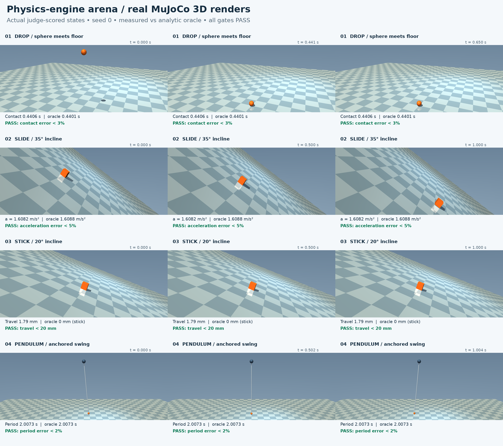

# Physics-engine arena: four scenes, one neutral spec, an analytic judge

An agent works on a real robotics-simulation engineering problem inside a
disposable sandbox: port one neutral scene spec (drop, incline stick,
incline slide, pendulum) into **MuJoCo** as a single Python file, and
iterate against a judge it cannot fool. The judge never accepts "the
solver ran": every scenario has a closed-form answer from Newtonian
mechanics — free-fall contact time √(2h/g), the static-friction criterion
μ > tan θ, the sliding acceleration g(sin θ − μ cos θ), and the pendulum
period with the finite-angle correction 2π√(L/g)·(1 + θ₀²/16) — and the
trajectory must land on it within stated tolerances, plus agree pointwise
with the judge's own reference MuJoCo port. Inspired by Manda Robotics'
physics-engine primer (https://mandarobotics.com/blog/comparing-physics-engines/primer.html),
which contrasts what different engines do on the same scenes; this demo
adds the missing piece — an analytic referee.

A sandbox helps because agent-written simulation code is exactly the kind
of thing you should not run on your own machine: the judge executes the
artifact from a copy, checksums itself before and after, and kills
misbehaving ports without touching anything local. The whole judge —
pinned mujoco 3.8.1 wheel set, self-test with 8 mutants, grading — runs
from nothing in a fresh sandbox in about two minutes.

## One-command run

From this repository's root, with Python 3.10+ and the `sbx` CLI
(`pip install "git+https://github.com/agent-next/sandbox#subdirectory=cli"`)
and `SBX_API_KEY` exported:

```bash
python3 cookbook/sim-engine-arena/run.py                    # CPU sandbox end-to-end
python3 cookbook/sim-engine-arena/run.py --gpu              # + optional mujoco_warp GPU replay
python3 cookbook/sim-engine-arena/run.py --ref sbx/arena-r2 # other repository ref
```

Each run prints wall time per step (clone, setup, selftest, grade), the
verdict JSON, and a short human summary, then kills the sandbox and
confirms it is gone. Measured in a fresh CPU sandbox (see RECEIPT.md):
create 2 s, clone 4 s, cold setup 24–36 s, selftest 12–17 s, grade 4–6 s,
total 63–69 s; `--gpu` adds ~2 min of GPU lane (warp kernels cold-compile
~25 s on a fresh lease — setup time, not sim time). Locally with a warm
venv the same judge steps take ~3 s / ~17 s / ~2 s.



[Watch the MuJoCo 3D render and PASS card](media/demo.mp4) · [Agent loop](media/loop.png).
Regenerate with `bash cookbook/sim-engine-arena/media/make_media.sh`
(Python 3.10–3.13, ffmpeg, DejaVu Sans fonts, EGL or OSMesa; installs pinned
local toolchains). The offscreen video replays the actual judge-scored
states, with the 35° sliding and 20° sticking boxes side by side.
Only visual assets are added to render-only copies of the artifact's
models; every frame is checked against the graded trajectory.

To try the judge locally on a CPU-only Linux box instead (run all three
from this repository's root — grade.sh resolves the artifact path
relative to your working directory):

```bash
bash cookbook/sim-engine-arena/judge/setup.sh      # pinned venv in ~/.venvs/sim-engine-arena
bash cookbook/sim-engine-arena/judge/selftest.sh   # known-good passes, 8/8 mutants killed
bash cookbook/sim-engine-arena/judge/grade.sh cookbook/sim-engine-arena/examples/good/sim.py
```

## The scene spec and its oracles

The agent sees `judge/spec.json` and nothing else — geometry, masses,
friction μ = 0.5, timestep 0.001 s, required CSV outputs, and **no
expected results**. The judge derives the answers from the spec itself:

| scenario | setup | oracle |
|---|---|---|
| drop | 1 kg sphere (r = 0.05 m), center at z = 1 m, onto a plane at z = 0 | contact at t = √(2(z₀−r)/g) = 0.4401 s |
| incline_stick | 1 kg box on a 20° incline, μ = 0.5 | tan 20° = 0.364 < μ: stays put |
| incline_slide | same, 35° | slides at a = g(sin θ − μ cos θ) = 1.6088 m/s² |
| pendulum | point mass, L = 1 m, released at θ₀ = 0.1 rad | T = 2π√(L/g)·(1 + θ₀²/16) = 2.0073 s |

## Ask your agent

With the sandbox plugin installed, paste this prompt. The agent writes
the port itself in a sandbox and iterates with the judge until it passes —
that loop is the demo:

> Create a fresh sandbox. Inside it, clone
> https://github.com/agent-next/sandbox at ref `main`, then read
> `cookbook/sim-engine-arena/SPEC.md` carefully: you are to write a
> MuJoCo port of the neutral scene spec as one file, `sim.py`, that reads
> `cookbook/sim-engine-arena/judge/spec.json` and writes the four
> trajectory CSVs exactly as the spec's artifact contract says. The spec
> contains no expected results — simulate honestly; any oracle number
> hard-coded in your file is rejected by gate 1. First run
> `cookbook/sim-engine-arena/judge/setup.sh`, then write your port, then
> iterate: `bash cookbook/sim-engine-arena/judge/grade.sh
> /path/to/your/sim.py --json /tmp/v.json` and read the verdict JSON
> until every gate passes (structure, run, csv-shape, oracle, and
> pointwise agreement with the judge's own reference port, which you
> never see). The judge's self-test shows what it rejects — run
> `judge/selftest.sh` once to see 8 broken mutants die. When every gate
> passes, report the verdict JSON (contact time, incline accelerations,
> pendulum period, worst agreement deviation), then kill the sandbox and
> confirm it is gone. If you cannot get a gate to pass, say exactly
> which gate and what you tried, and stop.

## What the judge checks (short form)

| gate | rule |
|---|---|
| structure | ≤ 96 KiB, byte-compiles, uses `mujoco`, reads the spec at runtime, no literal within 2 % of an oracle value |
| run | exits 0 within 900 s, writes all four CSVs |
| csv-shape | header = spec columns, row count within ±10 %, t starts at 0 and strictly increases, all values finite |
| oracle | drop contact time ±3 % of 0.4401 s; stick travel < 2 cm; slide acceleration ±5 % of 1.6088 m/s²; pendulum period ±2 % of 2.0073 s |
| agreement | max pointwise deviation vs the judge's reference port ≤ 5 % of per-scenario scale (0.05 m drop, 0.05 m incline, 0.02 rad pendulum, phase-aligned) |

The artifact is graded from a copy in a temp dir, and sha256 checksums of
`judge/` are compared before and after — the artifact cannot tamper with
its own judge. `judge/selftest.sh` grades 8 scripted mutants (time-stretched
trajectory, wrong gravity, friction ignored, wrong timestep, pendulum
length off 10 %, incline sign flip, crash, hard-coded oracle) and a
determinism check (two grades → byte-identical verdicts except `timing`);
kill rate 8/8 = 100 %.

## GPU lane (optional, never a gate)

`run.py --gpu` leases a 4 GiB VRAM slice over the agent-next REST API
(`POST /sandboxes {"accel":{"vram_gb":4,"reserve":"exec"}}`), uploads the
good port's four MJCF models (`examples/good/mjcf/`), replays each with
mujoco_warp 3.8.1, scores the replays against the same oracles, and shows
the GPU row in the summary — but the exit code never depends on it. The
lease is always `DELETE`d in a `finally` and the delete confirmed with
`GET` → 404. Warp kernels cold-compile ~25 s per fresh lease; that is
reported as setup time, not sim time.

## Limits, stated plainly

- The public artifact contract is **MuJoCo only**. The original arena ran
  the same spec through PyBullet, Genesis and Drake lanes as well; here the
  cross-engine comparison is the judge's reference port versus the agent's
  port, both in the same pinned MuJoCo (see SPEC.md, Non-goals).
- Contact models differ between engines (penetration and rebound depths in
  the drop, especially); the ±3 % contact-time tolerance absorbs that, but
  a port that dials in exotic solver settings to shave rebound is not what
  this demo rewards — the agreement gate caps pointwise deviation instead.
- The judge runs the artifact with its own pinned interpreter (CPython
  3.10–3.13, x86-64 Linux); a port needing other wheels fails gate 2.
- GPU is reported, not gated: a missing GPU seat on your key skips the
  lane and the CPU verdict stands.
