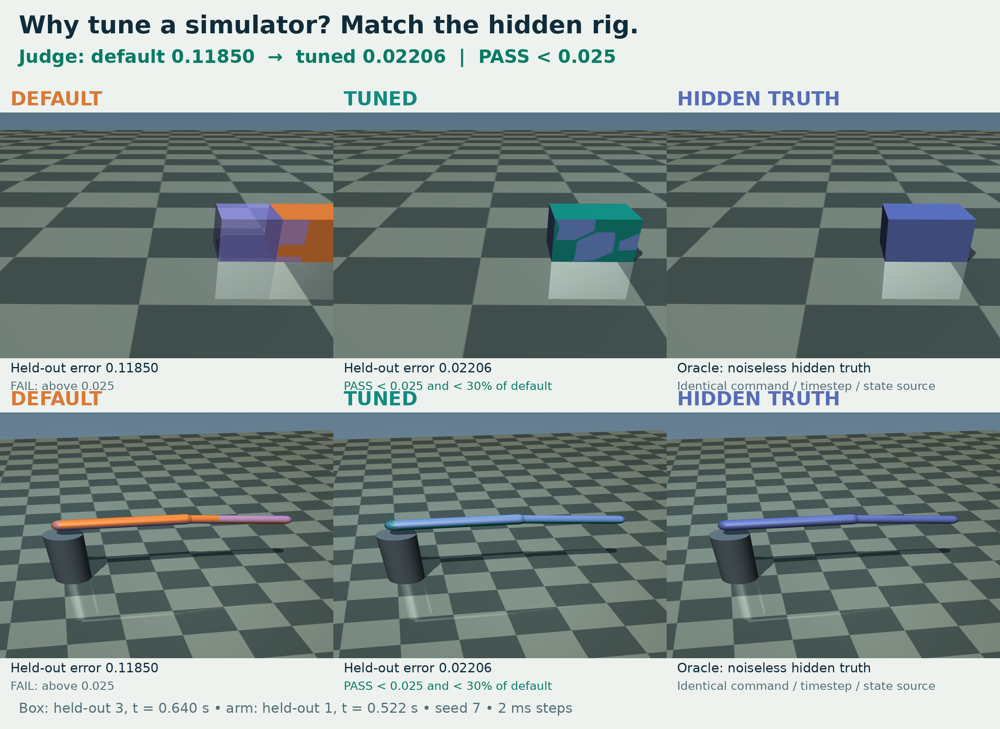

# Sim-tuner: make a simulator match the rig

The same servo command gives the wrong motion when the simulator's friction,
contact response, joint damping and armature are wrong. Fit those five
parameters from six noisy MuJoCo recordings, then test on four unseen commands.
The artifact is only five numbers, not a self-reported score: the judge runs
the physics itself and checks CPU MuJoCo against a batched GPU replay.
A disposable 4 GiB GPU sandbox supplies the pinned GPU stack and is deleted
after the run.



[Watch the synchronized 3D replay](media/demo.mp4) ·
[Recorded search and mutant kills](media/loop.png)

## One-command run

From this repository's root, with Python 3.10+ and `SBX_API_KEY` exported
(or `E2B_API_KEY`, with GPU access and credit):

```bash
python3 cookbook/sim-tuner/run.py
```

No local simulation packages or CLI are needed. The stdlib runner creates a
fresh GPU lease, uploads this checkout's judge and example, validates the
preinstalled stack, runs the self-test and grades the example. It prints the
complete verdict, kill rate and measured step times, then sends DELETE and
requires GET → 404. Use `--report-json out.json` to save the complete report,
`--seed 7` for the shipped fit, or `--selftest-only` to skip the final grade.
`--keep` is for exploration only: you then own cleanup.

If your environment routes HTTPS through a short-lived proxy, bypass it:

```bash
env -u HTTPS_PROXY -u https_proxy -u HTTP_PROXY -u http_proxy \
  python3 cookbook/sim-tuner/run.py --report-json out.json
```

The fresh-run timings and pasted outputs are in [RECEIPT.md](RECEIPT.md).
The command verifies the shipped fit, **it does not run a new parameter
search**. The recorded search took 732.3 s on CPU (`examples/good/loop.json`).
It is not evidence of a GPU search speedup.

| measured step, seconds | fresh run 1 | fresh run 2 |
|---|---:|---:|
| create lease | 4.1 | 3.0 |
| validate preinstalled stack | 0.2 | 0.3 |
| self-test | 67.9 | 71.4 |
| final grade | 5.6 | 5.7 |
| entire command, including transport and cleanup | 90 | 90 |

## What passes?

| check | measured at seed 7 | rule |
|---|---:|---|
| G1 parameters | five finite in-range numbers | strict JSON, exact keys |
| G2 train error | 0.016299 | reported, not an acceptance threshold |
| G3 held-out error | 0.022060 | < 0.025 |
| G3 fraction of default | 0.1862 | < 0.30; default error 0.118495 |
| G4 GPU vs CPU train error | 0.016322 vs 0.016299 | absolute difference ≤ 0.003 AND relative ≤ 10% |
| Self-test | 18/18 killed | known-good passes, every mutant fails a real gate |

Numbers above come from the real lease run recorded in `media/data/run-1.json`.
Same-seed CPU verdicts are deterministic apart from `timing`; GPU timing varies.

## Ask your agent

With the sandbox plugin installed:

> Read `cookbook/sim-tuner/SPEC.md`. Calibrate the five parameters of the
> box-and-arm rig using only the six training recordings. Use
> `judge/engine.py` for the known model, initial conditions and metric;
> do not use the truth parameters or held-out recordings while searching.
> Start from `tools/search.py`: it supports a batched mujoco_warp evaluator
> on a 4 GiB GPU lease, and a `--cpu` reference path. The box and arm are
> independent, so fit their channel groups separately, then polish the
> total training error. Save a strict five-number `params.json`, grade it
> with `bash cookbook/sim-tuner/judge/grade.sh params.json --seed 7`,
> and iterate until G1–G4 pass. Report the verdict, not your own score.
> Always delete leases you create and verify GET returns 404.

The supplied artifact was produced with the **CPU** path of that search,
followed by CPU pattern-search refinement. GPU evaluation is real and mandatory
for the numerical agreement gate. Search history identifies the engine used.

## Local judge and media

For CPU judge development (Linux x86-64, Python 3.10–3.13):

```bash
bash cookbook/sim-tuner/judge/setup.sh
bash cookbook/sim-tuner/judge/grade.sh cookbook/sim-tuner/examples/good/params.json --cpu-only
```

CPU-only validation reports G4 skipped and an incomplete verdict, not a full
demo PASS. Its exit code is 0 when the CPU checks succeed; require the JSON
`pass` field for full acceptance. Full grading and self-test require GPU access.

Regenerate all media, including a git-ignored lossless master:

```bash
bash cookbook/sim-tuner/media/make_media.sh
```

Requires Python 3.10–3.13 with venv/pip, ffmpeg/ffprobe, DejaVu Sans, and EGL
(OSMesa fallback). The script installs the pinned rendering environment.
The three-way replay uses actual states captured *inside* a CPU regrade;
all gated CPU numbers must equal the fresh lease receipt. Each rendered
qpos/qvel is checked against the captured data at 1e-9. See
`media/STORYBOARD.md`, `media/REVIEW.md` and `media/MANIFEST.json`.

## Limits

- These are **synthetic** recordings, not hardware measurements. The gap is
  parameter error plus seeded 1.5% measurement noise, not model-structure error.
- The hidden truth is withheld by convention from the optimizer, not protected
  against someone reading the public seeded generator. This is a correctness
  demo, not a secure benchmark or evidence of generalization to a real robot.
- The shipped parameters fit seed 7. Changing the seed changes the rig and
  requires refitting; an arbitrary seed is not a new passing reproduction.
- CPU and GPU paths use the same MuJoCo equations, with different numerical
  execution. Agreement is not an independent real-world physics oracle.
- GPU leases have a preinstalled stack, no outbound network and no API key.
  The runner uploads sources rather than cloning inside the lease. Setup is
  stack validation, not a cold pip installation. G4 uses this same fresh lease.
- Small workloads can run on CPU. No speedup, hardware transfer or secure
  hold-out claim is made.
- The video passes the mechanical gate but not the blind panel's quality bar.
  See `media/REVIEW.md`; this is not yet merge-ready.
