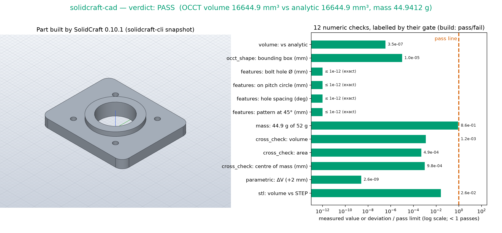
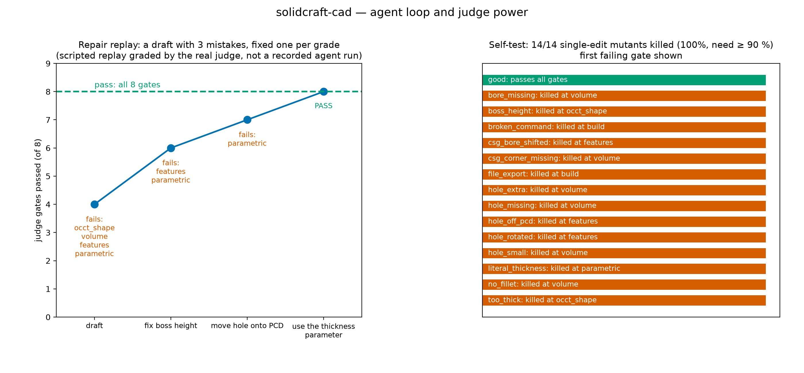

# solidcraft-cad — parametric CAD a judge can grade

An agent does mechanical design, not just file conversion. It writes a
[SolidCraft](https://github.com/bherbruck/solidcraft) command script for a NEMA 17
motor-mount adapter plate: a rounded plate, a centre bore, a raised boss, four
bolt holes on the motor's pitch circle, and a mass limit in aluminium. The
script must stay parametric, so changing `thickness` rebuilds the whole part.
SolidCraft is an open-source parametric CAD application in pure Rust with a
headless CLI and an MCP server for agents.

The judge does not trust SolidCraft's own numbers. It takes the STEP and STL
files SolidCraft delivers and re-measures them with a second CAD kernel
(OpenCascade 8.0.1), then compares them with numbers it computes by hand from
`spec.json`. A disposable sandbox suits this work: the agent gets a 26 MB CAD
binary, a 100 MB OpenCascade stack and a scratch filesystem to iterate in.
Your machine stays clean, and the graded artifact is one small JSON file.

## Results





[▶ demo.mp4](media/demo.mp4): 40 s. The video steps through the spec, then
SolidCraft building the part step by step, the delivered views, a live
`thickness` sweep (each frame a real SolidCraft rebuild), the judge verdict and
the agent loop (1920×1080, H.264).

Key numbers from the judge verdict on `examples/good/design.json`:

- **Volume**: OpenCascade 16644.9 mm³ vs analytic 16644.9 mm³ (relative deviation 6.9e-10, limit 0.2 %)
- **Hole pattern**: 4 × Ø3.4 on PCD 43.84 mm. Diameter, pitch circle and 90° spacing all within 1e-13 of nominal. Minimum edge distance 7.8 mm (limit ≥ 5)
- **Mass**: 44.94 g in 6061 aluminium (limit ≤ 52 g)
- **Two kernels agree**: SolidCraft vs OpenCascade volume 1.2e-6 and area 4.9e-7 relative, centre of mass within 1e-5 mm
- **Parametric**: `thickness` 6 → 8 mm adds 5124.18 mm³; the analytic value is 5124.18 mm³ (deviation 5e-12)
- **STL**: 3772 triangles, closed and consistently oriented, volume within 0.013 % of the STEP
- **Self-test kill rate**: 12/12 = 100 % (requirement ≥ 90 %)

## Ask your agent

> Set up a sandbox and solve the demo in `cookbook/solidcraft-cad/` of
> https://github.com/agent-next/sandbox (clone it first). Run
> `bash cookbook/solidcraft-cad/judge/setup.sh`, read
> `cookbook/solidcraft-cad/SPEC.md` and `cookbook/solidcraft-cad/spec.json`,
> then model the part yourself with SolidCraft. Write a command script
> `design.json` with a `thickness` parameter that drives the plate. Use
> `~/.local/solidcraft-0.10.1-linux-x86_64/bin/solidcraft-cli commands` to see
> every command, `solidcraft-cli eval design.json` to measure it, and
> `solidcraft-cli snapshot design.json --out part.png` to look at it.
> Iterate with
> `bash cookbook/solidcraft-cad/judge/grade.sh design.json --json v.json`
> until it exits 0, then paste the final verdict JSON and the snapshot. Do
> not edit anything under `judge/` or `spec.json`; if you believe the judge
> is wrong, say so instead of working around it. Kill the sandbox when you
> are done.

To let the agent drive SolidCraft as a tool rather than through scripts, add
its MCP server inside the sandbox:
`claude mcp add solidcraft -- ~/.local/solidcraft-0.10.1-linux-x86_64/bin/solidcraft-cli mcp`.
Its `screenshot`, `measure` and `inspect_design` tools give the agent the same
view as the judge's first gates. The graded artifact is still a command script,
so the agent saves the commands it ran as `design.json`.

## One-command run

```bash
pip install "git+https://github.com/agent-next/sandbox#subdirectory=cli"
export SBX_API_KEY=<your key>
python3 cookbook/solidcraft-cad/run.py          # --ref main --keep supported
```

The script creates a sandbox, clones the repo, installs the pinned tools, runs
the judge self-test, grades `examples/good/design.json` and prints the verdict
JSON. It then kills the sandbox and confirms it is gone. It uses the standard
library only, exits non-zero on any failure, and names the sandbox id if it
cannot confirm cleanup.

Measured wall time (2 vCPU sandbox, see RECEIPT.md): setup about 2.5 min
(downloads), self-test about 8 min (14 grades), one grade about 40 s.

## What the judge checks

Eight gates, all numeric (full rules in `SPEC.md`):

1. **build**: the script uses only modelling commands and SolidCraft builds it with no failing feature.
2. **occt_shape**: OpenCascade reads the STEP: one valid solid, bounding box within 0.01 mm.
3. **volume**: within 0.2 % of the closed-form volume.
4. **features**: bore, boss, corner fillets and bolt holes found as cylindrical faces in the STEP. Diameters are checked to 0.02 mm, the pitch circle to 0.05 mm, spacing to 0.1°, plus the edge distance.
5. **mass**: at most 52 g.
6. **cross_check**: SolidCraft's `eval` and OpenCascade agree to 0.1 %.
7. **parametric**: the judge bumps `thickness` by 2 mm, rebuilds, and the volume change must match the analytic value.
8. **stl**: the mesh is watertight, oriented, and matches the STEP volume to 0.5 %.

## Limits

- x86_64 Linux with CPython 3.12 or 3.13: the hashed wheels cover those. The
  agent-next default template has Python 3.12.
- SolidCraft is about one week old (the repo was created 2026-10-07; v0.10.1
  was released 2026-10-14). The demo pins that exact release by sha256. The
  standard's "nothing published in the last two weeks" rule cannot be met for
  it; see RECEIPT.md, Deviations.
- The judge checks one part family: plates with Z-axis holes. It is not a
  general CAD-equivalence checker.
- Grades take about 40 s, mostly OpenCascade start-up (vtk import) and two
  SolidCraft builds.

## Credits

SolidCraft (https://github.com/bherbruck/solidcraft), release v0.10.1, is
MIT OR Apache-2.0. It is downloaded at setup time and not vendored here.
OpenCascade via `cadquery-ocp` 8.0.1.0.0 (Apache-2.0 bindings, OCCT LGPL-2.1
with exception) from PyPI.
