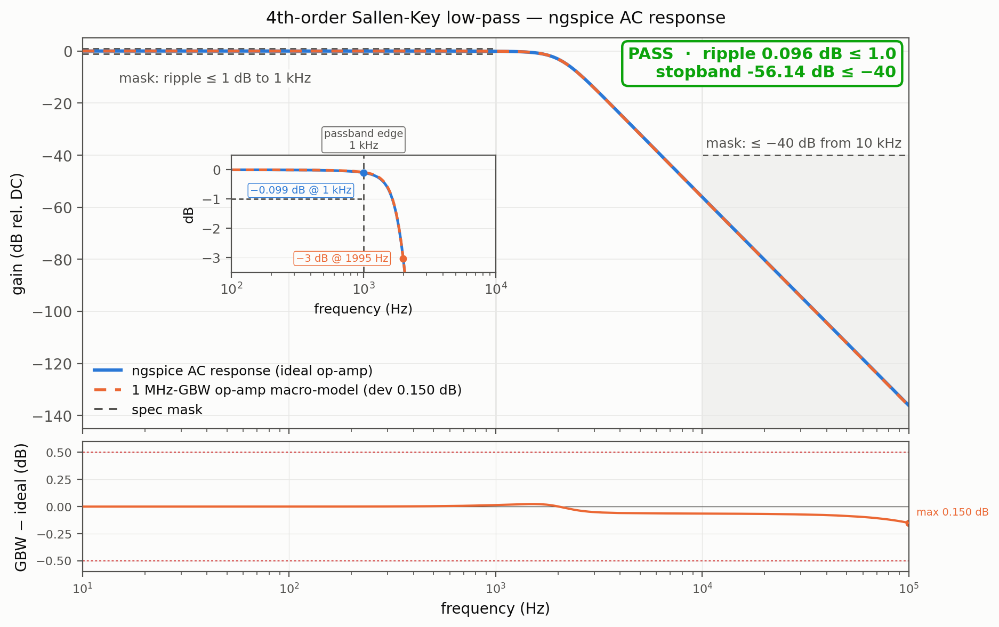
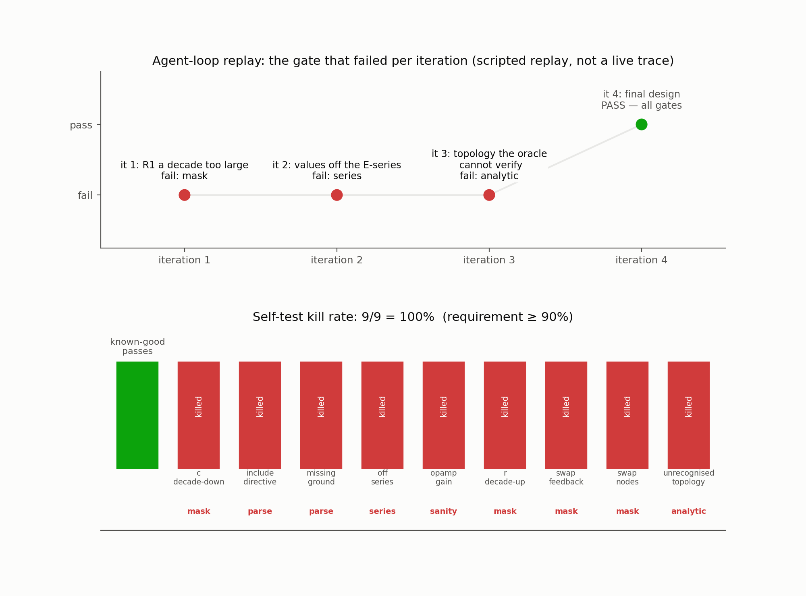

# spice-filter — analog design a judge can grade

An agent has to *design* electronics, not just run a simulator: produce a
SPICE netlist of a 4th-order active low-pass filter whose simulated AC
response meets a two-sided mask (ripple ≤ 1 dB up to 1 kHz, at least 40 dB
down from 10 kHz on), using only E24 resistor and E12 capacitor catalogue
values, robust enough that ≥ 90 % of a ±5 % R / ±10 % C Monte-Carlo still
meets a relaxed mask. The judge is ngspice plus an independent closed-form
cross-check — a netlist that "runs fine" but is mis-wired fails. A
disposable sandbox is the right place for this: the agent needs ngspice,
python3 and a throwaway filesystem to iterate designs in, and the graded
artifact is one small file it hands back.

## Results





[▶ demo.mp4](media/demo.mp4) — 40 s animation: ideal and GBW-limited sweeps drawn against the mask → finished result with passband inset → agent-loop replay → self-test kill-rate bars (1920×1080, H.264, 514 KB)

Key numbers from the judge verdict (`examples/good/lpf4sk.cir`):

- **Ripple**: 0.096 dB (limit ≤ 1.0 dB to 1 kHz)
- **Stopband**: −56.14 dB (limit ≤ −40 dB for f ≥ 10 kHz)
- **GBW macro-model deviation**: 0.150 dB (limit ≤ 0.5 dB vs. closed form)
- **Monte-Carlo pass rate**: 100/100 runs (limit ≥ 90 % on relaxed mask)
- **Self-test kill rate**: 9/9 = 100 % (requirement ≥ 90 %)

## Ask your agent

> Set up a sandbox and solve the demo in `cookbook/spice-filter/` of
> https://github.com/agent-next/sandbox (clone it first). Run
> `bash cookbook/spice-filter/judge/setup.sh`, read
> `cookbook/spice-filter/SPEC.md`, then design the artifact yourself: a
> SPICE netlist of a low-pass filter with input node `in`, output node
> `out`, ground `0`, driven by its own `AC 1` source, meeting ripple
> ≤ 1 dB to 1 kHz and ≤ −40 dB for f ≥ 10 kHz, with every resistor on the
> E24 and every capacitor on the E12 series, and passing the Monte-Carlo
> gate. Iterate with
> `bash cookbook/spice-filter/judge/grade.sh <your-netlist.cir> --json v.json`
> until it exits 0, then paste the final verdict JSON. Do not edit anything
> under `judge/`; if you believe the judge is wrong, say so instead of
> working around it. Kill the sandbox when you are done.

The known-good example in `examples/good/` is a unity-gain Sallen-Key
cascade; a working answer does not have to be.

## One-command run

```bash
pip install "git+https://github.com/agent-next/sandbox#subdirectory=cli"
export SBX_API_KEY=<your key>
python3 cookbook/spice-filter/run.py          # --ref main --keep supported
```

Creates a sandbox, clones the repo, installs pinned tools, runs the judge
self-test, grades `examples/good/lpf4sk.cir`, prints the verdict JSON, then
kills the sandbox and confirms it is gone. Stdlib only; exits non-zero on
any failure, naming the sandbox id if cleanup cannot be confirmed.

## Measured wall time (Debian sandbox, 2 vCPU)

| step | wall time |
|---|---|
| `git clone --depth 1` | ~1 s |
| `judge/setup.sh` (fresh install) | 3.2 s (idempotent re-run: 0.1 s) |
| `judge/selftest.sh` (good + 9 mutants + determinism) | 6.8 s |
| `judge/grade.sh examples/good/lpf4sk.cir` | 1.8 s |

Whole run, including sandbox create and kill: a few minutes; grading itself
is seconds. `run.py` prints a per-step timing line.

## Limits, plainly

- Small-signal AC only (linear): ideal op-amps via `E` sources; no noise,
  slew, supply or transient behaviour is graded — see SPEC non-goals.
- The judge pins ngspice 39.3+ds-1 from Debian bookworm and needs `sudo`
  once for the install; a non-Debian base image would need a different pin.
- The closed-form cross-check recognizes the Sallen-Key cascade shape
  only, and **fails closed** on anything else: an unrecognized topology
  cannot pass. `--allow-unverified` grades it on the remaining gates and
  marks the verdict `"unverified": true`.
- The ideal-op-amp oracle comparison is exact by construction (an `E`
  source *is* the textbook ideal buffer), so the judge also re-simulates
  with a 1 MHz-GBW op-amp macro-model, where the good design deviates a
  measurable ~0.15 dB (limit 0.5 dB) — see SPEC.
- Monte-Carlo defaults to 100 runs, one ngspice process each; budget
  ~15 ms/run on 2 vCPU.
