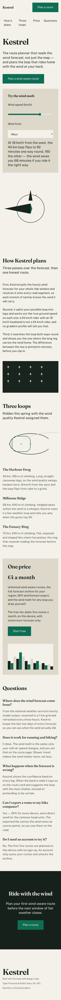
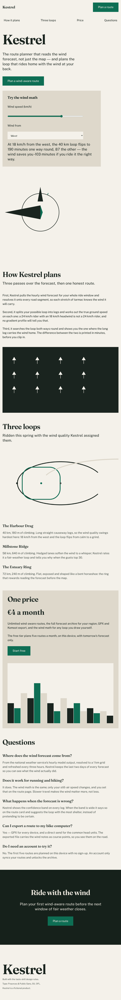
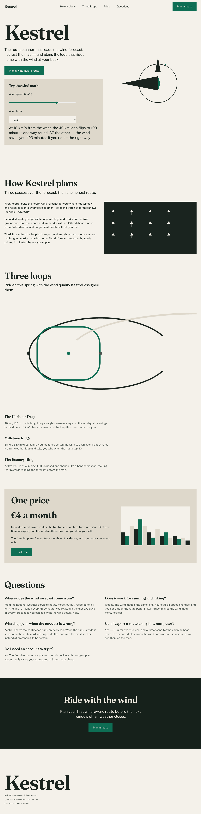

# taste-skill landing page — a design-taste skill for agents, judged in a browser

A disposable agent-next sandbox loads the open-source **taste-skill**
design rules — [Leonxlnx/taste-skill](https://github.com/Leonxlnx/taste-skill)
(MIT licence), pinned at commit
[`f624f37a8c650b9cc550253104925efe4c8de246`](https://github.com/Leonxlnx/taste-skill/tree/f624f37a8c650b9cc550253104925efe4c8de246)
("tasteskill v2", `skills/taste-skill/`) — and builds a polished one-page
marketing site for the fictional product in [`brief.md`](brief.md). A judge
the artifact cannot fool then loads the page in pinned headless Chromium
(Playwright 1.63.0, Chromium 153) at three widths and measures **from the
live DOM's computed styles** whether the site is clean, complete and in
taste: zero console errors and failed requests, no horizontal overflow,
WCAG AA contrast, every brief section present, and the taste-skill's own
measurable house rules — each gate cites the skill rule it enforces
(see [SPEC.md](SPEC.md) for the full numeric pass rules). A sandbox helps
because the browser toolchain (Chromium ~120 MB + Python venv) installs,
runs and is thrown away without touching your machine.

The artifact under test is a static site directory — `index.html` +
committed CSS/JS/fonts/images, no runtime network, no build step. The
judge serves a scratch copy on `127.0.0.1`, blocks and flags any
non-localhost request, and checksums `judge/` before and after grading.

The demo grades the same brief twice over: [`examples/good/`](examples/good/)
is written **with** the skill rules; [`examples/baseline/`](examples/baseline/)
is the honest first attempt **without** the skill (default fonts, small
grey text, a fixed-width container). Graded by the same judge, the verdicts
show the difference the skill makes (measured below).

## Measured results (real output in [RECEIPT.md](RECEIPT.md))

| | `examples/good/site` (with skill) | `examples/baseline/site` (without) |
|---|---|---|
| clean load (0 console errors / failed requests) | **pass** | pass |
| no horizontal overflow at 375/768/1440 px | **pass** | **FAIL** (fixed 1200 px container) |
| WCAG AA contrast (computed styles) | **pass** (min ratio 5.19:1) | **FAIL** |
| all brief sections present | **pass** | pass |
| taste rules (15 measurable skill rules) | **pass 15/15** | **FAIL 11/15** |
| axe-core 4.10.3, 0 critical/serious | **pass** | **FAIL** |
| wind widget minutes sane (no negative/NaN) | **pass** | pass (no widget) |
| **verdict** | **ALL GATES PASS** | **FAILS** |

Judge self-test: known-good passes, determinism holds (two grades at the
same seed byte-identical outside `timing`), the no-skill baseline exits
non-zero with a readable verdict (the exit-code contract), and **10/10
(100 %) known-bad mutants killed** — each a single edit (low contrast,
fixed-width container, missing section, console error, default Times font,
tiny tap targets, image without alt, wind-widget sign bug, gradient
button, clipped select text). Full transcript in [RECEIPT.md](RECEIPT.md).

### Media

Real screenshots taken by the judge pipeline (Playwright, headless
Chromium) of `examples/good/site` — see [`media/make_frames.py`](media/make_frames.py):

| 375 px | 768 px | 1440 px |
|---|---|---|
|  |  |  |

Scroll capture frames: [`media/scroll-00.png`](media/scroll-00.png) …
[`media/scroll-09.png`](media/scroll-09.png). [`media/demo.mp4`](media/demo.mp4)
is a ~30 s step-through of the same frames with the verdict captions;
`media/make_media.sh` regenerates it (and the gitignored lossless master)
from the frames, and [`media/MANIFEST.json`](media/MANIFEST.json) records
the source command and sha256 of every media file.

## Ask your agent

> Create a CPU sandbox. In it, clone https://github.com/agent-next/sandbox
> and run `bash cookbook/taste-skill-landing/judge/setup.sh` to install the
> pinned judge (Playwright + Chromium + axe-core). Then read the design
> rules of https://github.com/Leonxlnx/taste-skill (MIT, commit
> `f624f37` — the `skills/taste-skill` skill) and the product brief in
> `cookbook/taste-skill-landing/brief.md`, and build a one-page landing
> site as a static directory (`index.html` + committed assets, no runtime
> network). Iterate with
> `bash cookbook/taste-skill-landing/judge/grade.sh <your-site-dir> --seed 1`
> until every gate passes. Report the final verdict JSON and kill the
> sandbox when done.

## One-command run (with sandbox API)

```bash
export SBX_API_KEY=<your key>
pip install "git+https://github.com/agent-next/sandbox#subdirectory=cli"
python3 cookbook/taste-skill-landing/run.py          # add --ref <branch> or --keep
```

`run.py` creates a sandbox, clones this repo at `--ref` (default `main`),
runs `judge/setup.sh`, `judge/selftest.sh`, then grades
`examples/good/site` and `examples/baseline/site` with the same judge,
prints both verdict JSONs, and kills the sandbox (verifying via
`sbx list` that the id is gone) unless `--keep` is given. The grader's
contract is that `grade.sh` exits 0 only when every gate passes: `run.py`
therefore expects the good site to return exit 0 **and**
`all_gates_passed: true`, and the baseline to return a non-zero exit
**and** `all_gates_passed: false` with at least one failed gate — the
before/after contrast *is* the demo. `run.py` itself exits 0 on that
honest happy path and non-zero on any failure, naming the sandbox id if
cleanup could not be confirmed.

## In-sandbox / no API key (run directly inside any Debian 12 box)

If you already have a Debian 12 (bookworm) environment with 2 vCPU and
~4 GB RAM — or you are inside a sandbox created by another tool — you can
run the judge steps directly without `SBX_API_KEY` or `run.py`:

```bash
# 1. Install the pinned judge toolchain (~1 min; needs sudo for apt)
bash cookbook/taste-skill-landing/judge/setup.sh

# 2. Prove the judge can fail (good passes, 9/9 mutants killed, ~1 min)
bash cookbook/taste-skill-landing/judge/selftest.sh

# 3. Grade an artifact (one JSON verdict; 0 exit = every gate passed)
bash cookbook/taste-skill-landing/judge/grade.sh \
    cookbook/taste-skill-landing/examples/good/site --seed 42 \
    --json /tmp/verdict.json
```

## Limits

- No Lighthouse run: the accessibility gate is **axe-core 4.10.3**
  (zero `critical`/`serious` violations), the demo brief's sanctioned
  "equivalent axe-core check" — logged as a Deviation in
  [RECEIPT.md](RECEIPT.md).
- No subjective beauty score: only taste-skill rules that are
  machine-measurable from computed styles/geometry are gates; the rest
  stay in the skill. [SPEC.md](SPEC.md) lists every gate and its citation.
- Media: full-page screenshots at 375/768/1440 px, 10 scroll frames and a
  ~30 s captioned `demo.mp4`, all regenerable via `media/make_frames.py`
  and `media/make_media.sh` (see `media/MANIFEST.json`).

## Credits

- **taste-skill** — <https://github.com/Leonxlnx/taste-skill> — MIT licence,
  pinned at commit `f624f37a8c650b9cc550253104925efe4c8de246`. The gates cite
  `skills/taste-skill/SKILL.md` house rules, `references/colour.md` §8 and
  `references/layout.md` §2 rules each.
- Demo fonts — Fraunces and Public Sans, SIL Open Font License 1.1; see
  [`examples/good/site/assets/fonts/FONTS.md`](examples/good/site/assets/fonts/FONTS.md).
- axe-core — <https://github.com/dequelabs/axe-core> — MPL-2.0, v4.10.3.
- Playwright — <https://playwright.dev> — Apache-2.0, v1.63.0.
- Sample imagery (compass rose, wind arrows, route ribbons) is drawn in
  code from the subject by `media/make_images.py`, from the brand palette —
  no third-party photographs (the product is fictional; real imagery does
  not exist by design of the brief).
