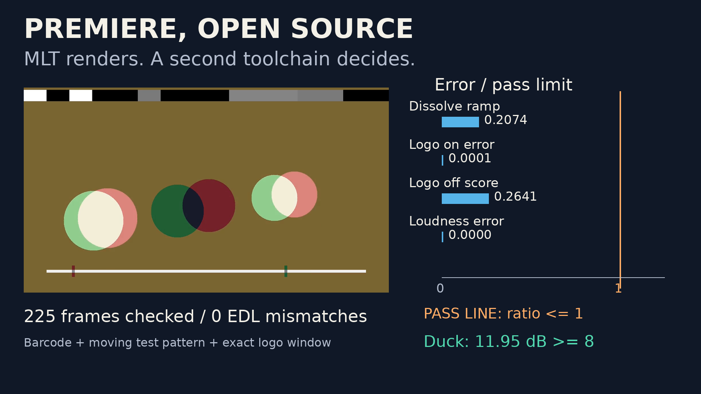
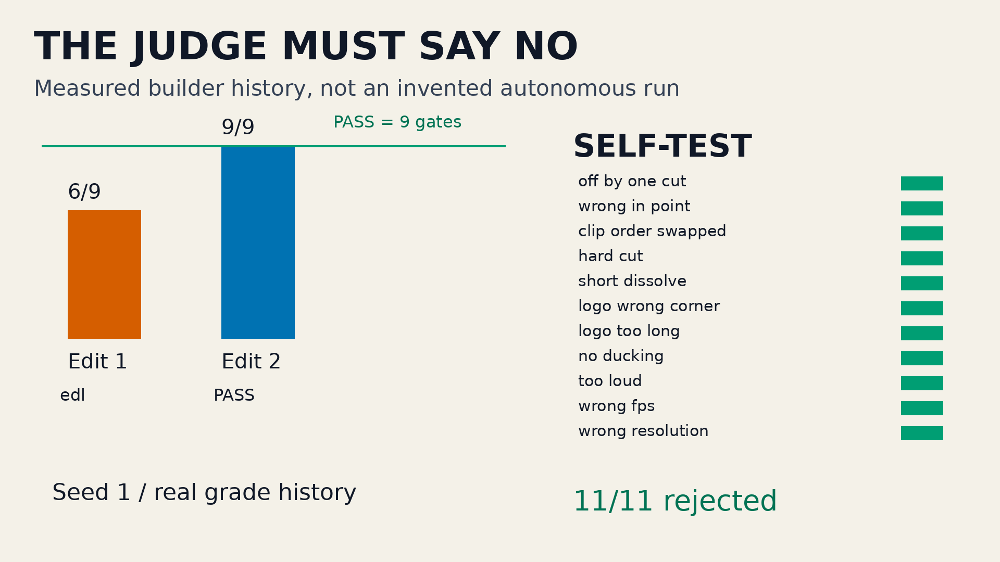

# Premiere, open source

An agent edits a video by writing an MLT XML timeline. Shotcut's `melt`
renders it; an independent ffmpeg/numpy judge reads the resulting pixels
and PCM. Synthetic moving test patterns carry a barcode naming every
source frame, so “the render completed” cannot hide a wrong cut. A
disposable sandbox holds the native video stack, generated sources and
scratch renders; your machine needs only Python and `sbx`.

**Measured edit:** 225 frames, zero EDL mismatches, −16.0 LUFS. The
self-test must reject all eleven deliberately broken timelines at their
intended gates. Exact measured output and commands: [RECEIPT.md](RECEIPT.md).

## Results




[44-second demo](media/demo.mp4): actual rendered edit → numeric brief →
frame-by-frame dissolve and provenance → audio → recorded sandbox run →
judge gates and mutant matrix. The sandbox log is replayed, not presented
as a recording of an autonomous editing agent.

## Ask your agent

> Clone https://github.com/agent-next/sandbox and run `bash cookbook/video-edit-mlt/judge/setup.sh` in a fresh sandbox.
> Read `cookbook/video-edit-mlt/SPEC.md` and `spec.json`, then write your
> own `edit.mlt`: A frames 0–99, a 25-frame dissolve A100–124 to B0–24,
> B25–99, then C50–74. Overlay the logo in its specified bottom-right
> rectangle on frames 0–99 only. Mix the supplied music and voice;
> duck music at least 8 dB in each voice window, master to −16 ±1 LUFS,
> and keep true peak at or below −1 dBTP.
> Use only relative `assets/` resources and the services allowed in
> `judge/security.py`; name every producer's `mlt_service` and point the
> root `<mlt producer="...">` at your output tractor. Relative resources resolve beside the XML, not
> beside the shell's current directory; the judge stages assets for you.
> The wrappers are under `$HOME/.local/video-edit-mlt/Shotcut.app/`;
> set `QT_QPA_PLATFORM=offscreen`. Use an affine transition on a separate
> logo track, not the watermark filter. MLT's animated volume property
> is `level` in dB. Iterate with
> `bash cookbook/video-edit-mlt/judge/grade.sh edit.mlt --seed 1 --json verdict.json`
> until it prints `"verdict": "PASS"`. Paste the final verdict and rendered
> frame. Do not modify the judge, spec or generated assets. Kill the
> sandbox and confirm it is gone when finished.

## One-command run

From the repository root:

```bash
pip install "git+https://github.com/agent-next/sandbox#subdirectory=cli"
# Set SBX_API_KEY (or E2B_API_KEY) in your environment.
python3 cookbook/video-edit-mlt/run.py
```

`--ref <branch>` clones another branch instead of `main`.
`--keep` deliberately leaves the sandbox up and prints its id.

The runner creates a **fresh** 120-minute sandbox, clones the requested
ref, installs pinned tools, runs unit tests and all mutants, grades the
good timeline, prints the verdict, and always kills its sandbox unless
`--keep` was requested. A failed `sbx list` never counts as confirmed
cleanup. Long jobs run detached with persistent logs and exit-status files.

Measured on the default CPU sandbox, seed 1:

| step | measured wall time |
|---|---|
| fresh setup | 77.7–83.2 s |
| complete selftest (27 unit tests, 11 mutants, determinism, integrity) | 196.1–203.0 s |
| final grade | 23.8–25.7 s |
| complete one-command run | 322.5–323.0 s |

Two fresh runs at the merged judge passed completely with identical
non-timing verdicts. Earlier builder runs, including one that lost its
final grade to an API outage, are kept in RECEIPT.md. The full mutation
proof takes about 5.4 min, just over the five-minute CPU target; a single
grade of your own timeline takes about 25 s. See RECEIPT.md for all output and deviations.

## How the judge works

- **Power:** decode all 450 raw source frames correctly before trusting
  the barcode reader.
- **Format:** MP4, H.264/AAC, 1280×720, 25 fps, exactly 225 decoded frames,
  square pixels, progressive, stereo 48 kHz. The renderer inherits the
  XML profile, so wrong-fps and wrong-resolution edits cannot be masked.
- **EDL:** zero cut-frame provenance or colour mismatches; dissolve
  barcodes match the expected two source frames within 0.12 normalized
  residual. Every output frame is checked.
- **Dissolve:** weight follows the 25-frame ramp within 0.20; endpoints
  and monotonicity have separate limits.
- **Logo:** normalized correlation ≥0.85 on every required frame,
  <0.30 on every other frame in the specified rectangle.
- **Audio:** ffmpeg EBU R128 integrated loudness −16±1 LUFS and true
  peak ≤−1 dBTP; 220 Hz projection measures ≥8 dB music reduction in
  **each** voice window.
- **Safety:** closed XML subset, trusted asset copy, no absolute paths,
  parent traversal, URLs, external XML or arbitrary services; judge
  checksums before and after.

`judge/selftest.sh` checks all eleven mutants at their intended gates,
same-seed determinism, judge integrity, barcode/EDL/blend unit tests,
unsafe-XML rejection and runner cleanup fault injection.

## Regenerate the media

Inside a sandbox after setup:

```bash
bash cookbook/video-edit-mlt/media/make_media.sh
# --reuse skips grading, using the recorded data and existing render.
python3 cookbook/tools/video_gate.py cookbook/video-edit-mlt/media/demo.mp4
python3 -m pytest -q cookbook/tools
python3 cookbook/tools/result.py check cookbook/video-edit-mlt/media/result.json
```

The script writes an ignored lossless master, then encodes H.264 CRF18,
preset slow, 1080p30, yuv420p, faststart. Figures are 200 dpi.
`MANIFEST.json` names each source and file hash.

## Limits and deviations

- Setup targets x86_64 Debian 12 / CPython 3.12. The launcher uses only
  Python 3.10+ stdlib. Shotcut 26.8.1 (released 2026-08-01) and all Python
  wheels are version- and SHA256-pinned; setup rechecks installed files,
  the downloaded archive and generated source hashes on reuse.
- This is a narrow, deterministic editing benchmark, not arbitrary
  footage analysis or general Shotcut XML compatibility. Zero-weight
  dissolve sources are unobservable; see SPEC.md for codec tolerances.
- XML validation is defense in depth, not an OS security boundary.
  Untrusted rendering belongs in a disposable sandbox.
- The two-model blind media review and different-family independent
  reproduction are separate acceptance requirements. Unperformed work is
  explicitly marked in `media/REVIEW.json` and `REPRODUCE.md`.

## Credits

[Shotcut 26.8.1](https://github.com/mltframework/shotcut/releases/tag/v26.8.1)
(GPL-3.0) supplies the official portable `melt`, `ffmpeg` and `ffprobe`
wrappers. No binaries are vendored. All source imagery, audio, timeline,
judge and media composition code are generated or written in this demo.
