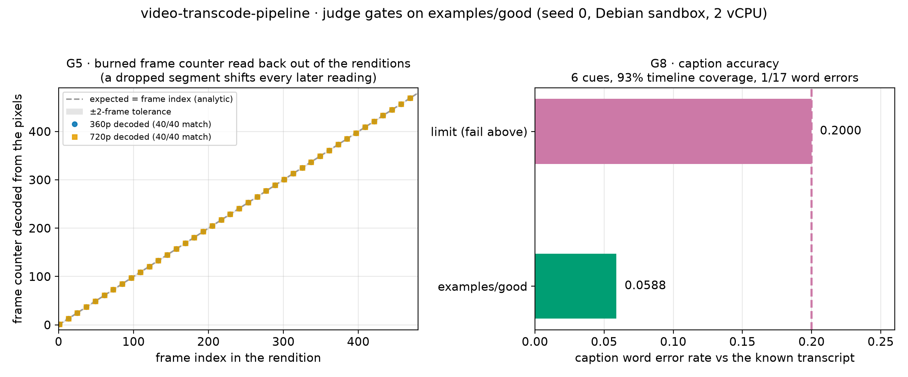
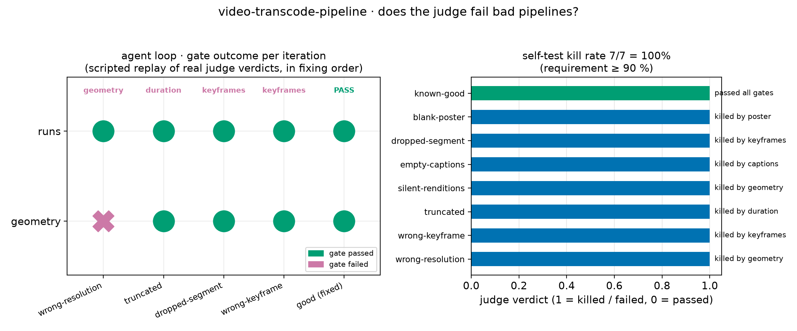

# video-transcode-pipeline — a media pipeline a judge can grade

An agent has to build a *video delivery pipeline*, not just run a converter:
one `pipeline.sh` that ingests an uploaded MP4 and emits a 360p/720p HLS
ladder with 2-second segments on a 4-second keyframe grid, a poster frame,
and WebVTT captions transcribed from the clip's speech track. The judge
checks the result against things the pipeline does not control: it decodes
the *source's* burned-in frame counter back out of the renditions with a
standard-library OCR (a dropped segment or a duplicated frame shifts every
later reading), scores the captions by word error rate against the known
transcript, and measures geometry, duration and keyframe spacing from the
bytes with ffprobe. A sandbox is the right place for this: the pipeline needs
ffmpeg, a speech-recognition model and a throwaway filesystem to iterate in,
and the graded artifact is one small script.

## Results





[▶ demo.mp4](media/demo.mp4) — 30 s animation: the source fixture with its
burned frame counter, the two renditions, the decoded counter read back
frame by frame, and the self-test kill-rate bars (1920×1080, H.264).

Key numbers from the judge verdict (`examples/good/pipeline.sh`, seed 0):

- **Frame-counter match**: 40/40 samples = 1.000 on both renditions (limit ≥ 0.95, tolerance ± 2 frames)
- **Caption WER**: 0.0588 (limit ≤ 0.20) over 17 reference words, 6 cues, 93 % timeline coverage
- **Keyframe gaps**: `[4.0, 4.0, 4.0, 4.0]` s on both renditions (4 s ± 1 %)
- **Duration deviation**: 0.0213 s from the source's 20.0000 s (limit 0.1 s)
- **Poster**: 640×360, 251/256 distinct luminance levels, centre 224 (background 0)
- **Self-test kill rate**: 7/7 = 100 % (requirement ≥ 90 %)

## Ask your agent

> Set up a sandbox and solve the demo in `cookbook/video-transcode-pipeline/`
> of https://github.com/agent-next/sandbox (clone it first). Run
> `bash cookbook/video-transcode-pipeline/judge/setup.sh`, read
> `cookbook/video-transcode-pipeline/SPEC.md`, then write the artifact
> yourself: a `pipeline.sh` that takes `--input <mp4> --out <dir> [--seed N]`
> and emits a 360p and a 720p HLS rendition (H.264 + AAC, 2 s segments,
> keyframes every 4 s), a poster PNG from t = 1 s, and WebVTT captions
> transcribed from `fixtures/speech.mp3`. Iterate with
> `bash cookbook/video-transcode-pipeline/judge/grade.sh examples/good --json v.json`
> until it exits 0, then paste the final verdict JSON. Do not edit anything
> under `judge/`; if you believe the judge is wrong, say so instead of
> working around it. Kill the sandbox when you are done.

The known-good example in `examples/good/pipeline.sh` is an ffmpeg HLS
encode plus whisper.cpp for the captions; a working answer does not have to
be.

## One-command run

```bash
pip install "git+https://github.com/agent-next/sandbox#subdirectory=cli"
export SBX_API_KEY=<your key>
python3 cookbook/video-transcode-pipeline/run.py    # --ref main --keep supported
```

Creates a sandbox, clones the repo, installs the pinned tools, runs the
judge self-test, grades `examples/good`, prints the verdict JSON, then kills
the sandbox and confirms it is gone. Standard library only; exits non-zero
on any failure, naming the sandbox id if cleanup cannot be confirmed.

## Measured wall time (Debian sandbox, 2 vCPU)

| step | wall time |
|---|---|
| `git clone --depth 1` | ~2 s |
| `judge/setup.sh` (fresh: 14 packages + cmake + whisper.cpp build) | 2 m 20 s (idempotent re-run: 2 s) |
| `judge/selftest.sh` (good + 7 mutants + determinism) | 2 m 11 s |
| `judge/grade.sh examples/good` | 21 s (of which 14 s is the pipeline, 10 s the counter OCR) |
| whole `run.py`, sandbox create to kill | ~7 min |

`run.py` prints a per-step timing line; the verdict carries a `timing` object.

## Limits, plainly

- The judge pins Debian bookworm packages and needs `sudo` once for the
  installs; a non-Debian base image would need different pins.
- `setup.sh` builds whisper.cpp from source at a pinned SHA, which is most
  of its 2 m 20 s. The model is `ggml-tiny.en` (English-only, 75 MB) — good
  enough for the 6-second clip the judge scores, not a general transcriber.
- The frame-counter OCR assumes the fixture's own layout: a monospace digit
  string burned at the position and size `fixtures/gen_fixtures.sh` uses,
  and it renders its digit templates from the same font at grade time. It is
  a decoder for *this* fixture, not a general OCR.
- Gate G5 reads the counter back from the decoded stream by frame index, so
  it detects dropped or duplicated frames and wrong-resolution renditions,
  but a rendition that is re-timed uniformly (all timestamps scaled) would
  still match frame for frame; G3 catches that case.
- Caption scoring is word error rate against one known transcript with a
  0.20 limit; the good pipeline lands at 0.059, so the margin is real but
  the tiny model's spelling errors (`jump` for `jumps`) are within it.
- Wall time on a 2 vCPU sandbox is dominated by the whisper.cpp build and
  the 1080p fixtures; the demo is sized to fit a 30-minute sandbox.
